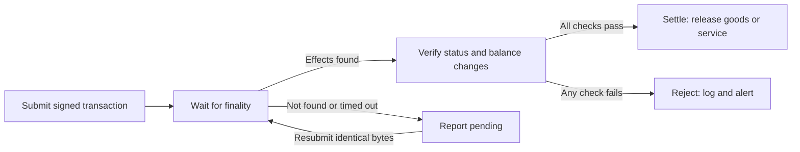

:::info Draft

This page is a draft pending review. Details can change before publication.

:::

An agent that sells a service must not release it until the payment is final and correct. Sui reaches finality in well under a second, but a submitted transaction can still fail, pay the wrong amount, or leave its outcome unknown when a network call times out. Verify-then-settle is the pattern that closes those gaps: the agent waits for finality, checks the effects against what it expected, and only then delivers.

## The verify-then-settle pattern

The pattern has 4 steps:

1. **Submit:** The payer or a facilitator submits the signed payment transaction.
1. **Wait for finality:** The agent waits until a full node returns certified effects for the transaction digest, not just an acknowledgment that it received the bytes.
1. **Verify:** The agent checks the execution status and the balance changes against the expected recipient, amount, and coin type.
1. **Settle:** Only after every check passes does the agent release the goods, service, or next operation.

The pending branch never loops back to a new payment. It loops back to the same signed bytes. See [When a transaction is not found or times out](#when-a-transaction-is-not-found-or-times-out).

## Submission is not settlement

A successful submission response means a full node accepted the bytes. It does not mean the transaction executed, or that it executed successfully. A transaction is final when a full node observes certified effects, either through a quorum of validator acknowledgments or through inclusion in a certified checkpoint. After that point Sui never reverts it ([Life of a Transaction](/develop/transactions/transaction-lifecycle#how-does-a-transaction-reach-finality)).

To wait for finality and read the result, look up the transaction digest with gRPC `LedgerService.GetTransaction` or the GraphQL `Query.transaction` field ([Life of a Transaction](/develop/transactions/transaction-lifecycle#how-do-i-resend-or-verify-a-pending-transaction)). In the TypeScript SDK, `client.waitForTransaction` and `client.getTransaction` wrap the same lookup. Request the effects and the balance changes explicitly. With gRPC, include `effects` and `balance_changes` in the read mask ([Querying Data with gRPC](/develop/accessing-data/grpc/using-grpc#field-path-reference)). The proposed x402 Sui exact scheme makes the same requirement for facilitators: ask for balance changes when the RPC returns them only on request, and treat a missing set as a failure, not a match ([x402#3081, Effects check](https://github.com/x402-foundation/x402/pull/3081)).

{/* TODO: Import code from MystenLabs/ts-sdks: a gRPC client waiting for a digest and reading effects and balanceChanges */}

## Check the execution status

A transaction that executed and aborted onchain is still final. The lookup returns it as a failed transaction, not as a missing one, so never treat a response as success without reading the status ([Life of a Transaction](/develop/transactions/transaction-lifecycle#how-do-i-resend-or-verify-a-pending-transaction)). In the TypeScript SDK, the result's `$kind` is `Transaction` on success and `FailedTransaction` on failure.

### Reverted transactions

When a transaction fails during execution, Sui rolls back its state changes: no transfer happens and no Move state changes persist. Gas is still charged, because validators did the work of executing it ([Gas Fees](/develop/transaction-payment/gas-in-sui#gas-budgets)). A [gasless stablecoin transfer](/develop/transaction-payment/gasless-stablecoin-transfers) that breaks the gasless rules is different: Sui rejects it before execution and charges no gas.

A reverted payment is final. Resubmitting the same bytes returns the same failure, so the payer needs a new, corrected transaction. Read the error from the failed result to decide whether that is worth attempting, for example when the payer's balance was too low, or whether the agent should stop and alert an operator.

## Verify the balance changes

Execution status tells you the transaction succeeded. Balance changes tell you whether it paid you. Each balance change records a coin type, an address, and a signed amount. Sui combines balance changes per address and coin type, so the recipient normally has 1 entry for the payment's coin type.

To verify a payment:

1. Select every balance change whose address is the expected recipient and whose coin type is the expected coin type. Compare full, normalized type strings, not substrings.
1. Add their amounts. If there are none, the total is zero.
1. Require the total to equal the expected credit exactly.

Use exact equality, not a minimum. The amount you expected is the price you quoted, so a different credit means the transaction does not match the payment you asked for, even when it is larger. The proposed x402 Sui exact scheme defines the check the same way: the facilitator sums the `payTo` entries for `asset` and requires the total to equal `amount`, and it does not inspect what the payer spent or who else the transaction paid ([x402#3081, Effects check](https://github.com/x402-foundation/x402/pull/3081)).

When the payment is in SUI and the recipient is also the gas owner, Sui folds gas into the same balance change, so the credit never matches the price. Avoid that combination rather than trying to correct for it.

Checking balance changes works the same way whether the payer drew from coins or from an [address balance](/onchain-finance/asset-custody/address-balances), and regardless of who paid gas.

### Bind the payment to its request

An exact amount to the right recipient proves you were paid, but not which request the payment was for. Bind each payment to the request it settles before you release anything:

- Record the transaction digest you expect to settle and accept that digest only once.
- If you issued a per-request reference, confirm the transaction carries it. The proposed x402 Sui exact scheme puts a server-issued nonce in a `Pure` input of the transaction for this purpose ([x402#3081, Server-issued nonce](https://github.com/x402-foundation/x402/pull/3081)).
- If you accept payments through [Payment Kit](/onchain-finance/payment-kit), its `PaymentReceipt` carries the nonce, amount, coin type, and receiver, and a `PaymentRegistry` rejects a second payment with the same composite key ([Payment Kit Standard](/onchain-finance/payment-kit#how-does-payment-kit-prevent-duplicate-payments)). Still check the balance changes as described in this section.

## Handle each outcome

| **What the lookup returns** | **What it means** | **What the agent does** |
| --- | --- | --- |
| Success, and balance changes match exactly | The payment is final and correct | Release the goods or service once for this digest |
| Success, but balance changes do not match | The transaction is final, but it is not the payment you asked for | Do not release. Log the digest and alert. Resolve any refund outside the payment flow |
| Failed | State rolled back, gas charged, transaction final | Do not release. The payer must build a new transaction |
| Not found, or the wait timed out | Outcome unknown | Report the payment as pending. See the next section |

A transaction that sends funds to the wrong address is final and cannot be reversed. This is a bug in whatever built the transaction, not a network failure. Prevent it by validating the recipient address before anyone signs the transaction, and by signing only transactions whose recipient comes from a trusted source rather than from the counterparty's request.

## When a transaction is not found or times out

A lookup that finds nothing does not prove the transaction never ran. The full node you asked might not have the transaction yet, because a node that missed submission learns about it only through state sync, which normally takes a few seconds ([Life of a Transaction](/develop/transactions/transaction-lifecycle#how-do-i-resend-or-verify-a-pending-transaction)). A node that has pruned old checkpoints also answers not found for a transaction that executed long ago.

So a not-found or timed-out transaction is not safe to retry with a new payment. If the original transaction executes after you sign a replacement, the payer pays twice. Instead:

1. Report the payment as pending, not failed, to whoever is waiting on it.
1. Resubmit only the identical signed bytes. Sui executes a given transaction at most once, and resubmitting an executed transaction returns its original result ([Life of a Transaction](/develop/transactions/transaction-lifecycle#how-do-i-resend-or-verify-a-pending-transaction)). Resubmitting the same digest can never cause a second payment.
1. Keep checking the digest until it returns effects, or until the transaction can no longer execute.
1. Only build a new payment after you have established that the original can never execute.

The proposed x402 Sui exact scheme follows the same rule. When a facilitator's submission was acknowledged but it cannot establish finality, it returns `settlement_pending` with the digest, which allows the resource server a single automatic retry of the same signed transaction, not a new one ([x402#3081, Settlement](https://github.com/x402-foundation/x402/pull/3081)).

### When a pending transaction can no longer execute

The x402 Sui exact scheme requires every payment to carry a `ValidDuring` or `Validity` expiration whose `minEpoch` and `maxEpoch` are at most 1 epoch apart ([x402#3081, Expiration](https://github.com/x402-foundation/x402/pull/3081)). Transactions that pay gas from an [address balance](/onchain-finance/asset-custody/address-balances/using-address-balances#how-do-i-pay-for-gas-from-an-address-balance) carry a `ValidDuring` expiration too. Once the current epoch is past `maxEpoch`, validators no longer accept those bytes.

A not-found result is conclusive only after all of the following are true:

- The current epoch is past the transaction's `maxEpoch`. While the window is open, the bytes can still execute.
- A margin has passed after the window closes. The spec keeps a successful settlement claim until at least 1 epoch after `maxEpoch` ends, because a node running an epoch behind could otherwise accept the payment ([x402#3081, Settlement deduplication](https://github.com/x402-foundation/x402/pull/3081)).
- The digest lookup returned a definite not found. A network error or timeout is unknown, not not found.
- The node you asked still holds history from before you first submitted the transaction, so a pruned result cannot pass for a missing one.

SuiPay's managed gateway applies these rules to x402 payments whose outcome is unknown. It records the signed bytes and digest as pending before it broadcasts them, and a background job marks a pending payment failed only with proof that the bytes can never execute: the `ValidDuring` window has closed plus 1 more epoch, the digest lookup returns not found, and every configured full node still retains history from when the record was written. Any unreadable input leaves the payment pending. For transactions that pin gas coins instead of carrying `ValidDuring`, the proof is that every pinned gas coin has moved to a newer version. {/* TODO: link SuiPay docs once public */}

## Poll or stream

Choose how the agent learns about outcomes based on its architecture:

| | **Polling** | **Streaming** |
| --- | --- | --- |
| **How** | Look up each digest with gRPC `LedgerService.GetTransaction` or GraphQL `Query.transaction` | Subscribe with gRPC `SubscriptionService.SubscribeTransactions`, `SubscribeEvents`, or `SubscribeCheckpoints` |
| **Best for** | Request-response agents that settle 1 payment at a time | Merchant backends that watch many incoming payments |
| **Complexity** | Low | Medium: manage the stream lifecycle, reconnection, and backfill |
| **API** | gRPC or GraphQL | gRPC only. GraphQL does not support subscriptions yet |

Streaming is available only through gRPC ([Data Access Interfaces](/develop/accessing-data/data-serving#when-to-use-graphql-or-grpc)). Subscriptions start at the current tip of the chain, so they do not replay anything you missed while disconnected. To avoid gaps, open the subscription first, note the first watermark it returns, and backfill with the list APIs up to that watermark ([Emitting Events](/develop/accessing-data/using-events#querying-events-with-grpc)). Each subscription accepts a read mask, so request `balance_changes` on transaction streams and apply the same exact-amount check to every payment you see ([Querying Data with gRPC](/develop/accessing-data/grpc/using-grpc#subscriptionservice-streams)).

For most agents, polling a known digest is enough. Whichever you choose, verify the effects of each payment before you settle it.

## Related pages

- [Hardening Payment Agents for Production](/onchain-finance/agentic-payments/production-hardening): Idempotency keys, kill switches, and monitoring.
- [Life of a Transaction](/develop/transactions/transaction-lifecycle): How a transaction reaches finality.
- [Address Balances](/onchain-finance/asset-custody/address-balances): Paying from balances instead of coin objects.
- [Payment Kit](/onchain-finance/payment-kit): Receipts and duplicate prevention for merchant payments.
