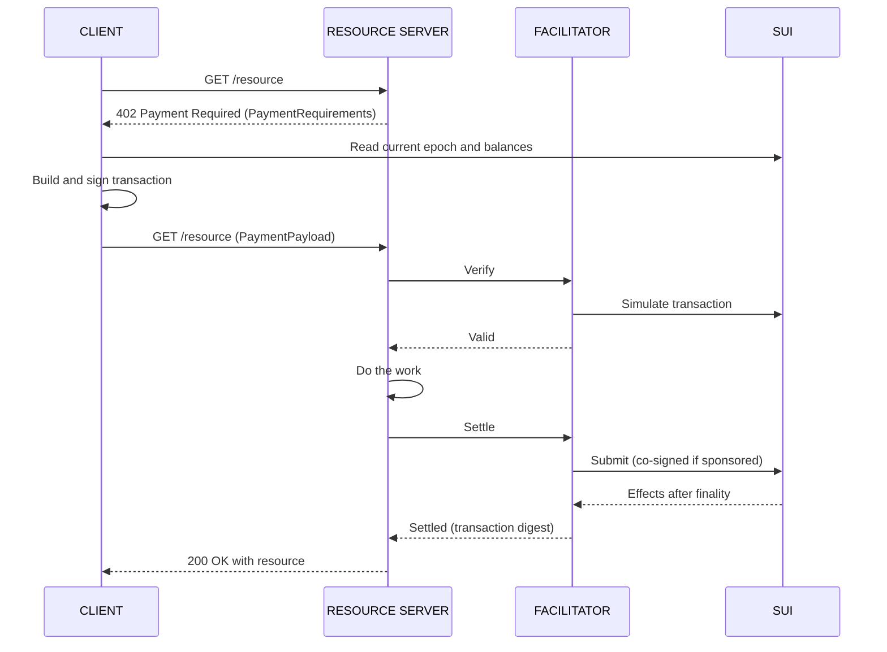

:::info Draft

This page is a draft pending review. Its content can change.

:::

x402 is an open protocol for paying for HTTP resources with the `402 Payment Required` status code. A scheme defines how a payment works on a given network. The `exact` scheme pays a specific amount of an asset to the resource server's recipient. On Sui, the client signs a complete transaction, so nobody else can change the amount or the recipient, and the facilitator accepts the payment only if the transaction's effects credit the recipient with exactly that amount.

:::caution

The proposed x402 `exact` scheme for Sui is a specification in [x402 PR #3081](https://github.com/x402-foundation/x402/pull/3081), which is open and not merged. Its reference implementation, `@x402/sui`, is in [x402 PR #3082](https://github.com/x402-foundation/x402/pull/3082) and is not yet published to npm. Unless noted otherwise, every rule on this page comes from the proposed `specs/schemes/exact/scheme_exact_sui.md` in x402 PR #3081.

:::

## Payment roles {#roles}

An x402 payment involves 3 parties:

- **Client:** The payer, such as an agent. It requests the resource, builds and signs the payment transaction, and retries the request with the payment attached. The transaction's sender is the payer.
- **Resource server:** The payee, also called the seller. It answers unpaid requests with `402` and its payment requirements, asks the facilitator to verify and settle the payment, and serves the resource.
- **Facilitator:** A service that verifies payments and submits them to Sui. When it sponsors gas, it co-signs the transaction as the gas owner at settlement.

## How a payment flows

The following sequence diagram shows the default flow:



The flow has 9 steps:

1. The client requests a resource and receives `402 Payment Required` with the `PaymentRequirements`.
2. The client reads the current epoch, and any balance or gas data it needs, from a Sui full node.
3. The client builds a transaction that credits `payTo` with exactly `amount` and arranges gas.
4. The client signs the transaction and resends the request with the `PaymentPayload`.
5. The resource server asks the facilitator to verify the payload.
6. The resource server fulfills the request.
7. The resource server asks the facilitator to settle. For a sponsored payment, the facilitator co-signs the client-signed bytes as gas owner.
8. The facilitator submits the transaction, waits for finality, and reports the result.
9. The resource server returns the response to the client.

This order is the default `authorization` flow. The scheme also allows an `upfront` flow on Sui, where the resource server settles before step 6. Sui typically finalizes a transaction in 400 to 700 ms ([Life of a Transaction](/develop/transactions/transaction-lifecycle#how-long-does-a-sui-transaction-take-to-finalize)), so `upfront` adds little latency, and a resource server can use it when the work is expensive.

Over HTTP, the requirements travel in the `PAYMENT-REQUIRED` header, the payload in the `PAYMENT-SIGNATURE` header, and the settlement result in the `PAYMENT-RESPONSE` header ([x402 HTTP transport](https://github.com/x402-foundation/x402/blob/main/specs/transports-v2/http.md)).

## Payment requirements

x402 v2 identifies networks with Chain Agnostic Improvement Proposal 2 (CAIP-2) identifiers. The Sui identifiers are `sui:mainnet`, `sui:testnet`, and `sui:devnet`.

The following example is illustrative. It asks for 0.01 USDC on Mainnet:

```json
{
  "scheme": "exact",
  "network": "sui:mainnet",
  "amount": "10000",
  "asset": "0xdba34672e30cb065b1f93e3ab55318768fd6fef66c15942c9f7cb846e2f900e7::usdc::USDC",
  "payTo": "0x1eb7c57e3f2bd0fc6cb9dcffd143ea957e4d98f805c358733f76dee0667fe0b1",
  "maxTimeoutSeconds": 60,
  "extra": {}
}
```

| **Field** | **Meaning** |
| --- | --- |
| `scheme` | Always `exact`. |
| `network` | The CAIP-2 network identifier, such as `sui:mainnet`. |
| `asset` | The coin type `T`, as a normalized Sui struct tag. |
| `amount` | The amount in the coin's smallest unit, as a positive integer string. USDC has 6 decimals, so `10000` is 0.01 USDC. |
| `payTo` | The recipient address. |
| `maxTimeoutSeconds` | How long the payment stays valid. Sui cannot enforce this today, so it is advisory. See [Expiration](#expiration). |
| `extra.feePayer` | Optional. The facilitator's sponsor address. The facilitator advertises it in its `/supported` response, and the resource server copies it into the requirements. |
| `extra.maxGasBudget` | Optional. The largest gas budget the sponsor accepts, in MIST, as an integer string. Present whenever `extra.feePayer` is present. |
| `extra.nonce` | Optional. A Base64 value the resource server issues for each challenge, which ties the payment to that challenge. |

The resource server must not put the epoch or other build hints in `extra`. The server compares the client's copy of `extra` to its own, and a Mainnet epoch lasts approximately 24 hours ([Networks](/develop/sui-architecture/networks)).

## Payment payload

The `payload` field of the `PaymentPayload` holds 2 values:

- `transaction`: The Sui transaction, serialized with Binary Canonical Serialization (BCS) and Base64-encoded.
- `signature`: One Base64 Sui signature per required signer, as a string or an array. The required signers are the sender and, if different, the gas owner. When the facilitator's sponsor is the gas owner, the client leaves the sponsor's signature out, and the facilitator adds it at settlement.

The full `PaymentPayload` also echoes the requirements the client accepted (illustrative values):

```json
{
  "x402Version": 2,
  "accepted": {
    "scheme": "exact",
    "network": "sui:mainnet",
    "amount": "10000",
    "asset": "0xdba34672e30cb065b1f93e3ab55318768fd6fef66c15942c9f7cb846e2f900e7::usdc::USDC",
    "payTo": "0x1eb7c57e3f2bd0fc6cb9dcffd143ea957e4d98f805c358733f76dee0667fe0b1",
    "maxTimeoutSeconds": 60,
    "extra": {}
  },
  "payload": {
    "transaction": "AAAA...AAAA=",
    "signature": "AbCd...=="
  }
}
```

## Build the payment transaction

The client builds one Sui transaction that credits `payTo` with exactly `amount` of `asset`. The funds can come from any source, including:

- An [address balance](/onchain-finance/asset-custody/address-balances)
- `Coin<T>` objects
- A swap
- A contract withdrawal
- Any mix of these

Verification looks only at the result. In the TypeScript SDK, `tx.balance()` chooses between the address balance and coins automatically ([Gasless stablecoin transfers](/develop/transaction-payment/gasless-stablecoin-transfers#how-txbalance-funds-a-transfer)).

{/* TODO: Import code from x402-foundation/x402/typescript/packages/mechanisms/sui/src/exact/client/scheme.ts (PR #3082, once merged), function: FUNCTION_NAME */}
{/* Description: Client builds an exact-scheme Sui payment transaction that credits payTo with exactly amount */}

### Set the expiration {#expiration}

The client must set a `ValidDuring` or `Validity` expiration with both `minEpoch` and `maxEpoch`, where `maxEpoch - minEpoch` is at most 1. It should use the current epoch and the next one. It must not set `minTimestamp` or `maxTimestamp`, because validators do not accept timestamps yet. The validity window is at most 2 epochs, about 48 hours on Mainnet ([Networks](/develop/sui-architecture/networks)).

Sui already requires this kind of expiration on transactions that use no owned objects, such as [gas paid from an address balance](/onchain-finance/asset-custody/address-balances#gas-payment-from-address-balances), and remembers their digests until the window passes so they cannot run twice. Object versions protect transactions that use owned objects instead. The scheme requires an expiration on every payment so that all payments share the same window. The expiration also names the chain, so a payment signed for one network cannot run on another ([`TransactionExpiration` source](https://github.com/MystenLabs/sui/blob/main/crates/sui-types/src/transaction.rs)).

### Server-issued nonce

When the requirements include `extra.nonce`, the client adds a `Pure` input that contains exactly the decoded nonce bytes, not BCS-encoded. If the client's Move commands need to read the nonce, it adds a separate BCS `vector<u8>` input for them.

The resource server returns the same nonce whenever it rebuilds the requirements for the same challenge, because the requirements are compared by value. It can store the nonce or derive it, for example as an HMAC of the challenge. Nothing consumes the nonce onchain, and settlement deduplication uses the transaction digest, not the nonce. A server that wants only one payment per challenge retires the challenge itself.

A payment with a nonce longer than 32 bytes is not eligible for a gasless transfer.

### Cover gas

The client has 3 ways to cover gas:

- **The facilitator's sponsor.** When the requirements include `extra.feePayer`, the client should use the sponsor. See [Sponsored payments](#sponsored-payments).
- **A gasless transfer.** When the payment qualifies as a [gasless stablecoin transfer](/develop/transaction-payment/gasless-stablecoin-transfers), it pays no gas. A gasless transfer pays an allowlisted stablecoin from the payer's address balance, credits at least 10,000 units ($0.01 for USDC) on Mainnet, has every `Pure` input at most 32 bytes, and creates or changes no objects, so a payment that mints a receipt object is not eligible. Gasless transactions get lower priority when the network is busy.
- **Its own gas.** The payer pays gas in SUI, or uses its own sponsor and includes that sponsor's signature in the payload.

## Sponsored payments

To use the facilitator's sponsor, the client builds the transaction with:

1. `sender` set to the payer.
2. Gas owner set to the facilitator's sponsor (`extra.feePayer`).
3. An empty gas payment, so gas comes from the sponsor's address balance.
4. A gas budget no larger than `extra.maxGasBudget`.
5. No command that uses `GasCoin`. A client paying in SUI with `tx.balance()` or `tx.coin()` passes `useGasCoin: false`.

The client signs as sender. At settlement, the facilitator co-signs the same bytes as gas owner and submits them with both signatures. The client does not contact the sponsor before signing: the requirements name the sponsor, and the gas payment is empty, so the sponsor selects no coins. For background on gas owners and sponsor signatures, see [Sponsored Transactions](/develop/transaction-payment/sponsor-txn).

Whenever the gas owner is one of the facilitator's sponsors, the facilitator checks the following at verify and again at settle:

- The gas payment is empty, so the transaction cannot name the sponsor's coins.
- The gas budget is at most `extra.maxGasBudget`.
- No command uses `GasCoin`, which would spend the sponsor's funds.
- No withdrawal draws from the sponsor, either as `Sponsor` or as `SenderAllowance` with the sponsor as funder.

These checks apply only to sponsored payments. A payer that covers its own gas can use `GasCoin`.

A sponsored transaction that Sui rejects for lack of funds costs the sponsor nothing. One that fails during execution costs up to its gas budget, so the sponsor should rate-limit each sender. The sponsor address should hold no other roles or permissions, because Move code can read `tx_context::sponsor()`.

## Verify a payment

The facilitator verifies a payment from its effects. Steps 1 to 5 are offline checks:

1. **Envelope:** `x402Version` is `2`, the scheme is `exact`, the network matches the requirements and is a supported Sui network, the payload has the shape `{ transaction, signature }`, the transaction bytes decode, and `amount` is a positive integer.
2. **Signatures:** The transaction has a sender, and the payload carries exactly 1 valid signature per required signer.
3. **Nonce:** When the requirements declare `extra.nonce`, it is valid Base64 and a `Pure` input equals the decoded bytes.
4. **Expiration:** The transaction carries a `ValidDuring` or `Validity` expiration with both epochs set and a span of at most 1.
5. **Sponsorship:** When the gas owner is one of the facilitator's sponsors, the transaction passes the sponsorship checks.
6. **Not already executed:** The facilitator recomputes the digest and looks it up. Simulating an executed address-balance transaction again still succeeds, so this lookup is needed. It is best effort, because a node that has not indexed or has pruned the transaction reports it as missing.
7. **Simulate:** The facilitator simulates the signed transaction unchanged, with transaction checks on and without letting the node pick gas. This catches an expired transaction. The facilitator rejects a simulation that used mocked gas, including for sponsored payments.
8. **Effects:** The simulated balance changes pass the effects check.

On success, the facilitator returns a `VerifyResponse` with `payer` set to the transaction's sender.

### Effects check

A balance change records a coin type, an address, and an amount. Sui combines balance changes per address and coin type, so `payTo` normally has 1 entry. The facilitator adds up the `payTo` entries for `asset` and requires the total to equal `amount`, no more and no less. It does not check what the payer spent or who else was paid.

When `asset` is SUI and `payTo` is also the gas owner, gas folds into the same balance change, so the payment cannot match.

## Settle a payment

At settlement, the facilitator:

1. Reruns the offline checks (verification steps 1 to 5).
2. Checks that the current epoch is within `[minEpoch, maxEpoch]`. A full node returns the cached result of an executed transaction without checking its expiration again, so without this check the facilitator would have to keep its claim forever.
3. Claims the transaction digest. If the digest is already claimed, it returns `duplicate_settlement`.
4. Submits the transaction and waits for finality. For a sponsored payment, the sponsor co-signs first, or declines with `sponsor_rejected`.
5. Requires a successful execution status and passes the effects check on the executed balance changes.

On success, the facilitator returns a `SettlementResponse` with the digest as `transaction`, the `network`, and the `payer`.

If submitting or waiting for finality fails, the facilitator looks the transaction up by digest and reports what actually happened. If the lookup also fails, it releases the claim and returns the digest in `transaction` so the resource server can follow up. When Sui acknowledged the submission but the facilitator could not establish finality, the facilitator returns `settlement_pending`, which allows the resource server one automatic retry of the same signed transaction. When the submission itself failed without an acknowledgment, it returns `transaction_failed`.

### Settlement deduplication

Sui executes a transaction at most once, but submitting an executed transaction again returns its original result as a success. The facilitator therefore deduplicates settlements so that it reports success at most once per transaction:

- The claim key is the transaction digest, per network.
- The facilitator claims the key only after the offline checks pass, so a forged payload cannot hold a real payment's key.
- Checking and recording a claim is atomic across concurrent settle requests.
- The facilitator keeps the claim only if settlement succeeds. A transaction that executed and failed returns the same failure when submitted again, so releasing its claim is safe.
- A successful claim is kept until at least 1 epoch after `maxEpoch` ends.
- When several processes serve settlement, they share one claim store. A facilitator whose settle endpoint can be called without verify should use a durable claim store.

`duplicate_settlement` means the payment has already settled, or a settlement for it is in progress. Funds are not reserved between verify and settle, so if the payer spends them elsewhere in between, settlement fails even if the resource was already served.

### Reason codes

| **Code** | **Stage** | **Meaning** |
| --- | --- | --- |
| `invalid_exact_sui_payload_invalid_expiration` | verify, settle | Expiration missing or malformed, span exceeds 1 epoch, or (at settle) the current epoch is outside the window. |
| `invalid_exact_sui_payload_sponsorship_rejected` | verify, settle | A sponsored transaction fails the sponsorship checks. |
| `invalid_exact_sui_payload_already_executed` | verify | The transaction has already executed. |
| `invalid_exact_sui_payload_transfer_mismatch` | verify | Simulated effects do not credit `payTo` with exactly `amount`. |
| `sponsor_rejected` | settle | The sponsor declined the transaction. |
| `duplicate_settlement` | settle | The transaction has already settled, or a settlement for it is in progress. |
| `settlement_pending` | settle | Submission was acknowledged, but finality could not be established and the lookup failed. |
| `transaction_failed` | settle | Execution failed or the outcome is unknown. |
| `settlement_effects_mismatch` | settle | Executed effects do not credit `payTo` with exactly `amount`. |

For the full list, see the reason code appendix in [x402 PR #3081](https://github.com/x402-foundation/x402/pull/3081).

## SuiPay and the `exact` scheme

The [SuiPay gateway](/onchain-finance/agentic-payments#payment-roles) uses an x402 v2 dialect on Sui, but it does not yet follow the proposed x402 `exact` scheme for Sui. A client that follows the scheme exactly cannot settle against a deployed SuiPay gateway today. The current differences are:

- **Guarded Move call instead of any transfer.** An onchain exclusion marker guards every offer that a deployed SuiPay gateway issues, so the transaction must contain exactly 1 Move call, to `payment::settle` (or `payment::settle_direct_to_refund_vault` for a refundable offer). The gateway refuses a plain transfer to `payTo`. The gateway accepts a transfer with no Move call only for an unguarded offer, and only when it uses `SplitCoins`, `MergeCoins`, and `TransferObjects`, so funds held only in an address balance cannot pay it.
- **Event check instead of effects-only verification.** For the `payment::settle` path, the gateway matches the `PaymentMade` event that the Move call emits against the offer, rather than checking balance changes alone.
- **Pinned gas coin instead of an empty gas payment.** When the payer spends from a SuiPay spend account (an experimental path, off by default for x402), the gateway's default gas source pins 1 leased sponsor coin in the offer and uses an `Epoch` expiration. An experimental address-balance gas source uses an empty gas payment with a `ValidDuring` window of at most 2 epochs, as the `exact` scheme does. When the payer pays from its own coins, it pays its own gas or uses an optional SuiPay gas sponsor.
- **Its own `extra` fields.** The SuiPay gateway carries its signed offer terms in `extra.suipay`, including `challengeId`, the offer digest, the payment path, and the sponsor gas pins (`sponsorGasOwner`, `sponsorGasBudget`, `sponsorGasPrice`, `sponsorGasPayment`), and declares `extra.paymentFlow` as `upfront`. It does not emit `extra.feePayer`, `extra.maxGasBudget`, or `extra.nonce`.
- **Replay returns the stored receipt.** When a client presents a byte-identical copy of an already-settled payment, the SuiPay gateway returns the stored success receipt with the same transaction digest and moves no funds, rather than returning `duplicate_settlement`. A resource server that settles through the SuiPay gateway records each delivery by settled digest so that a replayed payment header does not unlock the resource again.
- **Testnet only.** The SuiPay gateway settles on `sui:testnet` only. It does not support `sui:mainnet`.

{/* TODO: link SuiPay docs once public */}

{/* TODO(verify): recheck this list against the SuiPay gateway and the merged x402 spec before publishing. */}
