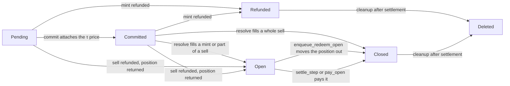

Trading on DeepBook Predict runs through the `deepbook_predict::expiry_market` module and, from protocol version 4, through the `queue` module of the `deepbook_predict_orders` package. One shared `ExpiryMarket` object exists per underlying and expiry, and it owns that expiry's USDC custody, strike exposure index, congestion estimator, mint pause flag, and flush stamp. Every call on this page is a `public fun` that you invoke from a programmable transaction block with a `moveCall`. Several of them take values only another command in the same block can produce, a transaction-local `Pricer` and a single-use account `Auth`, so plan the whole flow as one block.

The module lives at [`packages/predict/sources/expiry_market.move`](https://github.com/MystenLabs/deepbookv3/blob/2911743402372d3e79ab5d48a0f9ed64f1a32159/packages/predict/sources/expiry_market.move) on DeepBookV3 `main`. The Move snippets on this page pin DeepBookV3 at `29117434`, the protocol version 4 source that both networks run. For the package and object IDs of each network, see [Contract Information](/onchain-finance/deepbook/deepbook-predict/contract-information).

:::info

Both networks run Predict protocol version 4. Every trade is a queued order placed through the `deepbook_predict_orders` package, which [Queued orders](#queued-orders) covers. The immediate mint and live-redeem functions keep their signatures and always abort with `EDelayedExecutionRequired`, as [Retired immediate trades](#mint-a-position) describes.

:::

:::info

Collateral is the Move type `usdc::usdc::USDC`. On Mainnet that resolves to native USDC. On Testnet it is a mintable test coin at the same module path that displays as DUSDC and has no market value. Read the exact coin type from `getConfig(network).quoteCoinType` rather than assuming a symbol.

:::

## What is the `ExpiryMarket` shared object? {#expiry-market}

`ExpiryMarket` has the `key` ability, and the registry shares it at creation, so any transaction can name it as an input. Authorization comes from the arguments a function demands, not from object ownership.

| **Field** | **Type** | **Description** |
|---|---|---|
| `id` | `UID` | Object ID of the shared market. |
| `propbook_underlying_id` | `u32` | Propbook underlying this market prices against. The market stores no oracle object IDs. |
| `expiry` | `u64` | Settlement timestamp in Unix milliseconds. |
| `cash` | `ExpiryCash` | USDC custody plus the isolated inventory-impact reserve. |
| `fee_incentive_balance` | `Balance<USDC>` | Sponsor-funded USDC available to subsidize taker fees on this expiry. |
| `strike_exposure` | `StrikeExposure` | Exposure lifecycle state across this expiry's strike ticks. |
| `ewma` | `EwmaState` | Smoothed gas-price statistics behind the congestion surcharge. |
| `mint_paused` | `bool` | When true, new mints abort. Every other flow stays available. |
| `valuation_stamp` | `Option<ValuationStamp>` | `some` from a pool flush's snapshot stage until this market's `value_expiry` runs or the stamp goes stale. Trading never reads it and never waits on it. |

The field order in the table is declaration order, which is also the Binary Canonical Serialization (BCS) order of the object. `ValuationStamp` holds the flush sequence number and the market's cash and inventory-impact reserve at the snapshot instant; see [Vault](/onchain-finance/deepbook/deepbook-predict/contract-information/vault) for the flush that writes it.

<details>
<summary>`ExpiryMarket` source</summary>

<ImportContent
	source="packages/predict/sources/expiry_market.move"
	mode="code"
	org="MystenLabs"
	repo="deepbookv3"
	branch="2911743402372d3e79ab5d48a0f9ed64f1a32159"
	struct="ExpiryMarket,ValuationStamp"
/>

</details>

## Load a pricer {#load-a-pricer}

Every priced flow takes a `Pricer`, a snapshot of the oracle surface for one market. Build it with `load_live_pricer`, which reads the current canonical Propbook feeds for the market's underlying:

```move title='packages/predict/sources/expiry_market.move'
public fun load_live_pricer(
    market: &ExpiryMarket,
    config: &ProtocolConfig,
    propbook_registry: &OracleRegistry,
    pyth: &PythFeed,
    bs_values: &BlockScholesValueStore,
    bs_svi: &BlockScholesSVIStore,
    clock: &Clock,
    ctx: &TxContext,
): Pricer
```

The result has 3 properties that govern how you use it:

- **Abilities:** `Pricer` has `copy` and `drop` but no `store`. You cannot save it in an object or carry it between transactions, so every transaction that prices anything must call `load_live_pricer` first. Because it has `drop`, a block that ends up not using the value is still valid. Only the package constructs and thaws the storable `FrozenPricer` that a pool flush keeps between transactions, and no trade function accepts it.
- **Market binding:** A pricer binds to one market. It records `market.id()`, and any priced call that receives a pricer built for a different market aborts with `EWrongPricer`.
- **Oracle validation:** The load takes 4 Propbook objects and validates 3 of them: it checks the `PythFeed`, the `BlockScholesValueStore`, and the `BlockScholesSVIStore` each against the underlying's current canonical binding, and a mismatch aborts inside `pricing`. The load does not check the `OracleRegistry`, because it is the authority the load checks the other 3 against. The load also rejects an observation written earlier in the same transaction, and it aborts with `pricing::ELivePricingExpired` at or after the market's expiry.

In a programmable transaction block, a priced flow therefore runs in this order:

1. Call `load_live_pricer` for the market.
1. Pass the resulting `Pricer` to each priced call on that same market in the same block, such as a quote, a mint, `redeem_live`, `current_nav`, or `live_order_value`.

The load judges freshness against each input's own source timestamp: the Pyth feed timestamp and, for the Block Scholes price, forward, and stochastic volatility inspired (SVI) inputs, the provider's per-update timestamp. Both deployments run the Pyth spot and Block Scholes price windows at 2,000 ms and the SVI window at 10,000 ms.

See [Oracle](/onchain-finance/deepbook/deepbook-predict/contract-information/oracle) for how to discover the `PythFeed`, `BlockScholesValueStore`, and `BlockScholesSVIStore` object IDs for an underlying.

<details>
<summary>`load_live_pricer` source</summary>

<ImportContent
	source="packages/predict/sources/expiry_market.move"
	mode="code"
	org="MystenLabs"
	repo="deepbookv3"
	branch="2911743402372d3e79ab5d48a0f9ed64f1a32159"
	fun="load_live_pricer"
	noComments
/>

</details>

## Quote a mint {#quote-a-mint}

The module has 3 Move functions that price a prospective mint without changing market state. Each prices the order the way a queued fill would at the current clock. None is a preflight, and this section names the layer each claim belongs to:

```move title='packages/predict/sources/expiry_market.move'
public fun quote_mint(
    market: &ExpiryMarket,
    config: &ProtocolConfig,
    pricer: &Pricer,
    lower_tick: u64,
    higher_tick: u64,
    max_premium: u64,
    min_quantity: u64,
    exact_quantity: bool,
    clock: &Clock,
    ctx: &mut TxContext,
): MintQuote

public fun quote_mint_for_account(
    market: &ExpiryMarket,
    wrapper: &AccountWrapper,
    config: &ProtocolConfig,
    pricer: &Pricer,
    lower_tick: u64,
    higher_tick: u64,
    max_premium: u64,
    min_quantity: u64,
    exact_quantity: bool,
    root: &AccumulatorRoot,
    clock: &Clock,
    ctx: &mut TxContext,
): MintQuote

public fun quote_mint_exact_cost_for_account(
    market: &ExpiryMarket,
    wrapper: &AccountWrapper,
    config: &ProtocolConfig,
    pricer: &Pricer,
    lower_tick: u64,
    higher_tick: u64,
    max_cost: u64,
    min_quantity: u64,
    root: &AccumulatorRoot,
    clock: &Clock,
    ctx: &mut TxContext,
): MintQuote
```

The difference is whose terms the quote reflects. `quote_mint` prices an anonymous taker with no builder code. `quote_mint_for_account` reads the account's sticky builder code so the quoted builder fee matches what that account pays, and in budget mode it caps `max_premium` by the account's available USDC, including funds delivered through the accumulator but not yet settled.

Set `exact_quantity` to `true` to price a fixed size, in which case `min_quantity` carries the requested quantity. Set it to `false` to size a lot-rounded fill, a quantity in whole lots, under the `max_premium` budget. The [order-desk policy](#delayed-execution-policy) lists one lot as `10000` base units.

`quote_mint_exact_cost_for_account` prices an all-in budget: it returns the largest fill whose whole cost fits `max_cost`, capped at the account's available USDC, the way an `enqueue_exact_cost` fill would size at the clock. It returns the same `MintQuote` struct as the other 2 quotes, so read that fill and its cost decomposition through the getters in [The `MintQuote` struct](#mint-quote). It is the natural source of a `min_quantity` floor for the queued order that follows.

### What the quotes check {#quotes-v4}

The 3 quotes price and stop there:

- **No congestion surcharge:** `penalty_fee` is always 0.
- **Subsidy at the configured rate:** The fee subsidy is the admin-set subsidy rate applied to the trading fee, capped by the market's incentive balance.
- **Few gates:** They check only the pricer binding and that the clock is before expiry, aborting with `EInvalidOrderTiming` at or after it. They have no no-trade-window, trading-pause, or queue gate, and they check no slippage cap and no cash backing.
- **One refusal code:** A mint that Predict would refuse at the clock, for the entry-probability band, the minimum premium, or a cost above its maximum payout, aborts with `EOrderFailsLimits`.

Each quote runs the entry-probability band before it sizes anything. For a two-sided range the band applies 3 times: to the range probability, to the probability that settlement ends above the lower strike, and to the probability that it ends at or below the higher strike. An open end contributes no check, and the finite end of a directional position has the same probability as the position itself. The quoted `trading_fee` sums one fee for each finite boundary, as [Fee components](/onchain-finance/deepbook/deepbook-predict/design) describes.

The queued fill itself prices at its committed Pyth tick, not at the quote's clock, and placement checks the order without the fee subsidy, so a quote is an estimate of the fill rather than a promise. The SDK's `read.quoteMint` and `read.quoteMintCost` read these functions and preview a queued fill, with the order fee reported separately, and `read.planMint` adds the enqueue builder's preflight.

<details>
<summary>Quote source</summary>

<ImportContent
	source="packages/predict/sources/expiry_market.move"
	mode="code"
	org="MystenLabs"
	repo="deepbookv3"
	branch="2911743402372d3e79ab5d48a0f9ed64f1a32159"
	fun="quote_mint,quote_mint_for_account,quote_mint_exact_cost_for_account"
	noComments
/>

</details>

### The `MintQuote` struct {#mint-quote}

`MintQuote` has `copy` and `drop`, and it reports amounts in USDC base units except for `entry_probability`, which uses the 1e9 fixed-point scale. Read it through the 9 getters, each of which takes `&MintQuote` and returns `u64`:

| **Getter** | **Meaning** |
|---|---|
| `quantity` | Sized position quantity, which is also the maximum payout. |
| `entry_probability` | Quoted per-contract range probability before fees, scaled by 1e9. |
| `premium` | Net premium, the contract's entry value. |
| `trading_fee` | Trading fee before the sponsor subsidy, summed over the range's finite boundaries. |
| `fee_incentive_subsidy` | Sponsor-funded portion of the trading fee the trader does not pay. The SDK calls the same amount `subsidy`. |
| `builder_fee` | Builder add-on, zero when the account carries no builder code. |
| `penalty_fee` | Congestion surcharge. The SDK calls the same amount `penalty`, in both the quote and the decoded receipt. |
| `inventory_impact_charge` | Isolated risk escrow charge, separate from every ordinary fee. |
| `all_in_cost` | Total USDC withdrawal from the account. |

`all_in_cost` is `premium + (trading_fee - fee_incentive_subsidy) + builder_fee + penalty_fee + inventory_impact_charge`. Pass that value, not `premium`, as the `max_cost` cap on the mint. See the [Design](/onchain-finance/deepbook/deepbook-predict/design) page for how the package computes each fee component.

The congestion surcharge is one mechanism with 2 names, `penalty_fee` onchain and `penalty` in the SDK. Protocol version 4 retires it: its setters abort with `EEwmaRetired`, and every quote and fill reports 0. The field stays in the struct and the events because their layout is published. The sponsor subsidy is the same pairing: `fee_incentive_subsidy` onchain, `subsidy` in the SDK.

<details>
<summary>`MintQuote` and its getters</summary>

<ImportContent
	source="packages/predict/sources/expiry_market.move"
	mode="code"
	org="MystenLabs"
	repo="deepbookv3"
	branch="2911743402372d3e79ab5d48a0f9ed64f1a32159"
	struct="MintQuote"
/>

<ImportContent
	source="packages/predict/sources/expiry_market.move"
	mode="code"
	org="MystenLabs"
	repo="deepbookv3"
	branch="2911743402372d3e79ab5d48a0f9ed64f1a32159"
	fun="quantity,entry_probability,premium,trading_fee,fee_incentive_subsidy,builder_fee,penalty_fee,inventory_impact_charge,all_in_cost"
	noComments
/>

</details>

### The referral split {#referral-split}

The Move `MintQuote` has no referral field. That is not an omission: the chain computes the split after `all_in_cost` is already fixed, so there is nothing about it a quote could report. The chain computes it as:

```text
referral_fee_basis = trading_fee - fee_incentive_subsidy
referral_fee       = referral_fee_basis * referral_fee_rate / 1e9
```

The chain then splits the result out of the USDC payment the trader has already made. It comes out of fees already paid, is never an extra debit, and never changes `all_in_cost`, so a trader with a referrer and a trader without one pay exactly the same total for the same trade. The amount is zero unless `new_with_referrer` created the account.

The SDK's fill receipts report it, because that value comes from the `OrderMinted` event rather than from the Move quote. It is there for visibility, and the SDK deliberately does not add it into `cost`. [Referrals](/onchain-finance/deepbook/deepbook-predict/design) covers how an account gets a referrer, the rate, and how the payment reaches the referrer.

## Queued orders {#queued-orders}

A mint or an early sell is a queued order: the trader places it with its limits and its money, it waits in its market's queue until Pyth Lazer publishes its signed price for the order's price instant, called τ, and then any caller can commit that price and fill or refund the order. τ falls about 800 ms after placement on both networks.

:::info

Both networks passed the delayed-execution cutover, so every trade on either is a queued order. Read `protocol_config::version_watermark`, or call the SDK's `client.predict.read.executionMode()`, to confirm a network's path.

:::

The Move snippets in this section pin DeepBookV3 `main` at [`29117434`](https://github.com/MystenLabs/deepbookv3/tree/2911743402372d3e79ab5d48a0f9ed64f1a32159), the protocol version 4 source. Mainnet's publishes come from `98128174`, whose Mainnet builds are byte-identical. The order-flow sources are at [`packages/predict_orders/sources`](https://github.com/MystenLabs/deepbookv3/tree/2911743402372d3e79ab5d48a0f9ed64f1a32159/packages/predict_orders/sources), and the math library is at [`packages/predict_math/sources`](https://github.com/MystenLabs/deepbookv3/tree/2911743402372d3e79ab5d48a0f9ed64f1a32159/packages/predict_math/sources).

### Why orders wait {#why-orders-wait}

Predict prices a queued order at Pyth's signed price for a fixed instant after placement, rather than at whatever spot is onchain when the trader's own transaction executes. Neither the trader nor the filler picks that instant or that price.

### Order-flow packages {#order-flow-packages}

Sui caps a package at 102,400 bytes, and Predict, which can grow only by compatible upgrade, is close to that limit. Delayed execution therefore spans 3 packages:

| **Package** | **Role** |
| --- | --- |
| `deepbook_predict` | Upgraded in place to protocol version 4. Keeps the markets, pricing, fills, fees, cash backing, settlement, and the pool. Adds the order-flow primitives the queue drives, one `OrderReceipt` for each queued order, and a per-market `OrderFlowLedger`. |
| `deepbook_predict_orders` | Published fresh. Holds the shared `OrderDesk` with the delayed-execution policy, one shared `MarketQueue` for each market, each order's escrow, every order entrypoint, the queue reads, and the queue events. |
| `deepbook_predict_math` | Published fresh. A pure library: the pricing math Predict calls, the order-ID decoder, and `LazerPrice`, a price that only a Pyth-verified Lazer update can produce. |

The dependency runs one way: `deepbook_predict_orders` depends on Predict, and Predict depends on `deepbook_predict_math`. Predict never names a type from the order-flow package, so Predict's own surface does not change when the order-flow package does.

Predict makes every pricing, fill, and solvency decision itself. Each primitive the queue calls is one complete Predict operation that checks its own gates, decides the accounting, and moves the cash. The order-flow package owns what Predict leaves to it: τ and the deadline, capacities and per-account caps, cohort order, escrow custody, refund routing, and the events.

#### Shared objects {#order-flow-objects}

Publishing `deepbook_predict_orders` created and shared 2 objects:

- `OrderDesk`: Holds the [delayed-execution policy](#delayed-execution-policy) and the order-flow package's own version floor. Every trading call reads it, and only the admin's policy setters write it.
- `QueueRegistry`: The root that every market's queue ID derives from. Only queue creation writes it, so creating a queue never contends with trading.

Each market has one `MarketQueue`, a shared object at an ID derived from the `QueueRegistry` and the market. `queue::queue_id(registry_id, expiry_market_id)` returns that ID whether or not the queue exists yet, and the SDK's `client.predict.queueIdFor(marketId)` derives the same ID offchain. `queue::create_and_share(registry, desk, market, ctx)` creates a market's queue. Anyone can call it, the caller pays its storage, and a second call for the same market aborts. The protocol's market keeper creates each new market's queue right after it creates the market.

### The cutover and what retired {#cutover}

Predict protocol version 4 compiles `constants::current_version!()` as `4`, and `ProtocolConfig.version_watermark` reaching 4 is the delayed-execution cutover:

- **Admission waits for the cutover.** Predict refuses every queued order with `protocol_config::ECutoverNotReached` until the watermark reaches 4. The bump also retires every older Predict version, so no package that knows nothing about the queue can run while an order waits. The watermark only moves up, so nobody can undo the cutover.
- **Predict serves only an allowlisted order flow.** An admin runs `protocol_config::set_order_flow<OrderFlow>(true)`, where `OrderFlow` is the order-flow package's witness type. Until then, every admission, commit, and fill aborts with `EOrderFlowNotAllowed`. The allowlisting landed with each network's cutover and emitted `OrderFlowUpdated`.
- **The immediate trades always abort.** `mint_exact_quantity`, `mint_exact_amount`, `mint_exact_cost`, and `redeem_live` keep their signatures and abort with `EDelayedExecutionRequired`, at any watermark. Their Sessions wrappers abort through them. [Retired immediate trades](#mint-a-position) covers them.
- **The mint quotes price a queued fill.** `quote_mint`, `quote_mint_for_account`, and `quote_mint_exact_cost_for_account` keep their signatures and price the order like a queued fill at the current clock. See [Quotes from protocol version 4](#quotes-v4).
- **The congestion surcharge is gone.** `set_ewma_params` and `set_ewma_enabled` abort with `EEwmaRetired`, and every fill and quote reports `penalty_fee` as 0.
- **Settled redemption is unchanged for account positions.** `redeem_settled` pays positions that immediate mints left in accounts before the cutover. A queued fill never enters an account, so it never needs it. Protocol version 4 also limits `redeem_settled_permissionless` to an admin allowlist of keepers, as [Redeem a position](#redeem-a-position) describes.
- **Only flush operators finish a pool flush.** `plp::finish_flush` aborts with `ENotFlushOperator` unless the sender is on an admin-managed allowlist. See [Vault](/onchain-finance/deepbook/deepbook-predict/contract-information/vault#finish-stage).

### Who calls what {#roles}

A trader, or a [session](/onchain-finance/deepbook/deepbook-predict/contract-information/sessions#predict-wrappers) acting for one, places orders through the `queue` module of `deepbook_predict_orders`. Every step after placement is open to anyone and needs no account authority: `commit`, `resolve`, `refund`, `settle_step`, `cleanup`, `pay_open`, and `claim_parked` in the order-flow package, plus Predict's `rebalance_expiry_cash` and `try_settle`. The protocol's keepers normally make those calls, with no special rights. Only a holder of Predict's `AdminCap` can allowlist the order flow, change the policy, refund orders by ID, bump the order-flow package's version floor, or edit the flush-operator allowlist.

### The order lifecycle {#order-lifecycle}

The queue keeps each order as one record in a table, keyed by a sequential `u64` record ID that restarts in every market. A record ID is not the packed `u256` order ID of a position. Each record holds Predict's `OrderReceipt` for its order and that order's own escrowed USDC, so a refund pays exactly what that order escrowed.

| **Status** | **Code** | **Meaning** | **Leaves the status by** |
| --- | --- | --- | --- |
| Pending | `0` | Waiting for its cohort's price | A commit, or a refund |
| Committed | `1` | Priced, waiting to be resolved | A fill, or a refund |
| Open | `2` | Holds a position: a filled mint, the rest of a partial sell, or a refunded sell | An early sell, or the settlement payout |
| Refunded | `3` | A refunded mint | `cleanup` after settlement |
| Closed | `4` | Its position was sold, moved to a sell, or paid at settlement | `cleanup` after settlement |
| RefundDue | `5` | Reserved. Nothing sets it at launch | A refund |



The kind codes are `0` for an exact-quantity mint, `1` for a premium-budget mint, `2` for an all-in budget mint, and `4` for an early sell of an Open record. Code `3` is reserved, and nothing uses it. The package never renumbers status, kind, and refund reason codes, but it might add new ones, so tolerate codes you do not know. The `order_queue` module exposes a getter for every code, such as `order_queue::status_open()`, so a client never has to hard-code the numbers.

There is no cancel. Once you place an order, it fills or the queue refunds it.

### How do I place a queued order? {#place-an-order}

4 entrypoints in the `queue` module place orders. Each takes the market's queue, the market, the account wrapper and an `Auth`, the `OrderDesk`, `ProtocolConfig`, the Propbook `OracleRegistry`, and the canonical `PythFeed`, `BlockScholesValueStore`, and `BlockScholesSVIStore`, and each returns the new record ID as a `u64`. None takes a `Pricer`: placement reads the oracle objects itself and snapshots the volatility inputs into the order. The all-in budget mint and the early sell look like this:

```move title='packages/predict_orders/sources/queue.move'
public fun enqueue_exact_cost(
    queue: &mut MarketQueue,
    market: &mut ExpiryMarket,
    wrapper: &mut AccountWrapper,
    auth: Auth,
    desk: &OrderDesk,
    config: &ProtocolConfig,
    propbook_registry: &OracleRegistry,
    pyth: &PythFeed,
    bs_values: &BlockScholesValueStore,
    bs_svi: &BlockScholesSVIStore,
    lower_tick: u64,
    higher_tick: u64,
    max_cost: u64,
    min_quantity: u64,
    root: &AccumulatorRoot,
    clock: &Clock,
    ctx: &mut TxContext,
): u64

public fun enqueue_redeem_open(
    queue: &mut MarketQueue,
    market: &mut ExpiryMarket,
    wrapper: &mut AccountWrapper,
    auth: Auth,
    desk: &OrderDesk,
    config: &ProtocolConfig,
    propbook_registry: &OracleRegistry,
    pyth: &PythFeed,
    bs_values: &BlockScholesValueStore,
    bs_svi: &BlockScholesSVIStore,
    record_id: u64,
    close_quantity: u64,
    min_probability: u64,
    min_proceeds: u64,
    root: &AccumulatorRoot,
    clock: &Clock,
    ctx: &mut TxContext,
): u64
```

The 4 entrypoints differ only in their sizing and limit arguments:

| **Entrypoint** | **Sizing at τ** | **Trader limits** |
| --- | --- | --- |
| `enqueue_exact_quantity` | Exactly `quantity` | `max_cost` caps the all-in cost, and `max_probability` caps the entry probability. |
| `enqueue_exact_amount` | The largest lot-rounded quantity whose premium fits `max_premium` | `min_quantity`, and `max_cost` caps the all-in cost. |
| `enqueue_exact_cost` | The largest lot-rounded quantity whose all-in cost fits `max_cost` | `min_quantity` |
| `enqueue_redeem_open` | `close_quantity` of the Open record `record_id` | `min_probability` and `min_proceeds` |

Every queued mint requires a finite `max_cost`: zero and `std::u64::max_value!()` both abort with `EMintCostCapRequired`. The immediate `mint_exact_quantity` accepted `u64::MAX` as no cap, and the queued form does not.

<details>
<summary>Enqueue source</summary>

<ImportContent
	source="packages/predict_orders/sources/queue.move"
	mode="code"
	org="MystenLabs"
	repo="deepbookv3"
	branch="2911743402372d3e79ab5d48a0f9ed64f1a32159"
	fun="enqueue_exact_quantity,enqueue_exact_amount,enqueue_exact_cost,enqueue_redeem_open"
	noComments
/>

</details>

#### What placement checks {#placement-checks}

Placement runs these checks in order, and an abort charges nothing:

1. **Queue checks.** The desk's version floor, the queue's own desk and market (`EWrongDesk`, `EWrongMarket`), the [stuck gate](#queue-limits) (`EQueueStuck`), the side's capacity (`EQueueFull`), and the account's cap on waiting orders in this market (`EAccountOrderCap`).
1. **Timing.** The order gets its τ, deadline, and cutoff, and τ must fall before the cutoff (`EPastCutoff`).
1. **Source record, for sells.** The record must be Open (`ERecordNotOpen`, also for a missing ID) and belong to the placing account (`ENotRecordOwner`). `close_quantity` must be at least `min_sell_quantity`, and a partial sell must leave at least that much (`EBelowMinSell`).
1. **Budget and order fee.** A mint needs an available balance above the order fee (`EFeeNotCovered`), and its budget is `min(max_cost, available - order_fee)`. An exact-quantity mint also caps the budget at `quantity`, because a fill never costs more than its quantity. A sell needs a balance of at least the order fee and escrows nothing else.
1. **Predict's gates.** The order-flow allowlist, the version gate, so the emergency freeze blocks placement, and the cutover. Mints also check the trading pause and the market's mint pause. An early sell is open during both pauses.
1. **Predict's timing bounds.** `EInvalidOrderTiming` unless τ sits on the policy channel's grid at most one tick before the clock, τ is before the deadline and before `expiry - no_trade_window_ms`, and the deadline is at least 5 seconds before expiry.
1. **The volatility snapshot.** Placement validates the oracle objects the way `load_live_pricer` does and copies the Block Scholes spot, forward, and SVI into the order. It requires `use_pyth_spot_for_forward` (`pricing::EPythForwardRequired`) and an SVI no older than the policy's `svi_max_age_ms`. It does not require a fresh onchain Pyth spot.
1. **A dry run at placement.** Predict prices the order at the placement clock, without the fee subsidy, using the same test a fill applies. An order that the fill test would already refund for its limits or for admission aborts with `EOrderFailsLimits`, and so does a sell above the held quantity.
1. **Spare cash, for mints.** The mint's [cash need](#queue-limits) must fit the market's spare cash (`EInsufficientMarketCash`). Sells skip this check.
1. **Boundary nodes, for mints.** Placement creates both finite boundary nodes of the range in the payout tree if they are missing, and pins them, so a fill never creates a node. The payout tree's node cap applies here.
1. **Append.** The budget and the order fee move from the account into the record's escrow, and `OrderEnqueued` reports the order.

An early sell moves the whole position, with its receipt, out of its source record into the sell's new record, and marks the source Closed. After any sell, the trader's position therefore lives under the sell's record ID, and `OrderEnqueued.source_record_id` names the record it came from.

#### τ, cohorts, the deadline, and the cutoff {#order-timing}

τ is the last tick of the policy's Pyth Lazer channel at or before `t0 + delay_ms`, where `t0` is the onchain clock of the placing transaction. τ never falls below the market's last τ, and it moves to the next tick when it would otherwise join a price that is already committed. A cohort is every order in a market that shares one τ, so orders placed within one channel tick share one signed update and one commit.

The deadline is `min(τ + stall_timeout_ms, expiry)`, never earlier than the market's last deadline. At or past its deadline, the queue can only refund an order in full. The cutoff is `expiry - max(no_trade_window_ms, stall_timeout_ms + 5_000)`, and an order whose τ would fall at or past it aborts with `EPastCutoff`. Every deadline therefore falls at least 5 seconds before expiry, so every waiting order is due before the market can settle.

Both networks run an 800 ms delay on the 200 ms channel, a 5-second stall timeout, and a 10-second no-trade window. τ then falls 600 to 800 ms after placement, the deadline falls 5 seconds after τ, and the cutoff falls 10 seconds before expiry, so new orders stop about 11 seconds before expiry. Each order keeps the τ, deadline, channel, and order fee from its placement, so a change to those reaches only new orders. A change to `pyth_price_buffer_ms` or `gap_wait_ms` also reaches cohorts already waiting, because `commit` reads both from the desk when it runs.

### Commit and resolve {#commit-and-resolve}

2 permissionless calls move a waiting order to its outcome:

```move title='packages/predict_orders/sources/queue.move'
public fun commit(
    queue: &mut MarketQueue,
    market: &mut ExpiryMarket,
    desk: &OrderDesk,
    config: &ProtocolConfig,
    updates: vector<Update>,
    clock: &Clock,
    ctx: &TxContext,
)

public fun resolve(
    queue: &mut MarketQueue,
    market: &mut ExpiryMarket,
    desk: &OrderDesk,
    config: &ProtocolConfig,
    max_orders: u64,
    deny_list: &DenyList,
    clock: &Clock,
    ctx: &TxContext,
): u64
```

`commit` attaches verified Pyth Lazer prices to waiting cohorts. Each `pyth_lazer::update::Update` in `updates` must come from the Pyth Lazer verifier earlier in the same programmable transaction block. A cohort accepts only the update stamped exactly at its τ on its own channel, or, when the policy's `pyth_price_buffer_ms` is above zero and the clock is at least `gap_wait_ms` past τ, the update one channel tick later. Testnet runs the buffer at zero, so only the exact τ update counts. A cohort commits whole or not at all, a cohort without a usable price never holds back another cohort, and `commit` never commits a cohort at or past its deadline. Committing a mint also reserves its fee subsidy from the market's incentive balance. `commit` emits `CohortCommitted`.

`resolve` fills or refunds committed orders from the market's own cash, walking cohorts in τ order and records in placement order. It visits at most `max_orders` records, and never more than 450 in one call, which keeps a call under Sui's limit of 1,024 events for each transaction. That cap bounds events, not the objects a call loads, so size `max_orders` from measured costs. For each record:

- **Past the deadline:** Refunded with reason 5, never filled.
- **Receive address denied:** Refunded with reason 9 before anything is priced. See [Denied recipients](#denied-recipients).
- **Committed:** Filled at its committed price. Predict rebuilds a pricer from the order's own volatility snapshot, re-anchored on the committed Pyth price and rolled to the committed tick, so the trading fee is charged at the tick rather than at the resolve transaction's clock.
- **Fails at its tick:** Refunded with the reason it failed on, before anything moves.
- **More than the market's cash covers:** Refunded with reason 8 and the order fee returned. Fills never draw on the pool.

Orders usually fill in placement order, but not always: the queue prices and fills each cohort on its own, so a caller holding 2 updates can commit and resolve a later cohort first. Each order keeps its own τ price, so fill order changes only which order reaches scarce market cash first.

A mint fill pays from the record's escrow. Market cash receives the premium, the inventory-impact charge, which joins its isolated reserve, the whole trading fee net of any referral share, part of which the reserved subsidy pays, and the order fee. The builder fee and the referral share leave for their addresses, except that a fee owed to an address on USDC's deny list stays in market cash, unused subsidy returns to the market's incentive balance, and unused budget returns to the trader's receive address. A sell fill pays the trader the redeem value plus any inventory-impact rebate, less the trading and builder fees. Predict emits its usual `OrderMinted` or `LiveOrderRedeemed`, with `penalty_fee` 0, and the order-flow package emits `QueuedOrderFilled` beside it.

The protocol's keeper normally commits and resolves each cohort, usually in one transaction within a second of τ. The SDK's `client.predict.tx.fill` builds the same transaction for anyone who holds Pyth Lazer access: it verifies signed Lazer payloads against the current Lazer package, read from Pyth Lazer's `State` object, commits them, and resolves the market's due records.

<details>
<summary>Commit and resolve source</summary>

<ImportContent
	source="packages/predict_orders/sources/queue.move"
	mode="code"
	org="MystenLabs"
	repo="deepbookv3"
	branch="2911743402372d3e79ab5d48a0f9ed64f1a32159"
	fun="commit,resolve"
	noComments
/>

</details>

### Open records and early sells {#open-records}

A queued fill never enters the trader's account. A filled mint stays in the market's queue as an Open record owned by the placing account, holding the open receipt with the position's packed order ID, its root ID, its open time, and its held quantity. The position itself sits in the market's payout tree like any other, so the protocol backs it, values it in the pool's net asset value, and settles it the same way. Because the account's position table never sees it, `predict_account` reads and the SDK's `read.positions` do not list it: follow it by its record ID.

An Open record leaves the Open status in one of 2 ways:

- **Sold early.** `enqueue_redeem_open` sells some or all of it before the cutoff. A partial fill leaves the remainder Open under the sell's record ID, and a refunded sell returns the whole position to an Open record.
- **Paid at settlement.** The [`settle_step`](#queue-settlement) payout walk pays it in cash to the account's receive address, or `pay_open` pays it later when the walk had to skip it.

`quote_redeem_open` prices a prospective early sell without changing anything:

```move title='packages/predict_orders/sources/queue.move'
public fun quote_redeem_open(
    queue: &MarketQueue,
    market: &ExpiryMarket,
    wrapper: &AccountWrapper,
    pricer: &Pricer,
    record_id: u64,
    close_quantity: u64,
    clock: &Clock,
): RedeemQuote
```

It prices the close at a live `Pricer` from `load_live_pricer`, with the account's builder fee and the trading fee at the current clock, the way a sell fill prices at its tick. Its `proceeds` are before the order fee. It aborts with `ERecordNotOpen` for a missing or non-Open record, and it does not check that the account owns the record. Position reads such as `live_order_value` and `settled_order_payout` take the packed order ID, which `queue::order(queue, record_id)` returns in the record's `OrderView`.

### Why was my queued order refunded? {#queued-refunds}

Every refund returns the record's own escrow to the trader's receive address, keeps the order fee for reasons 1 and 2, and returns any reserved subsidy to the market's incentive balance. A refunded mint becomes Refunded, and a refunded sell returns to Open, holding its position. Each refund emits `QueuedOrderRefunded`.

| **Reason** | **Code** | **When** | **Order fee** |
| --- | --- | --- | --- |
| Limits | `1` | The order misses its own limits at its tick. | Kept, into market cash |
| Admission | `2` | A mint fails admission at its tick, such as the entry-probability band or the minimum premium, or the order cannot be priced there. | Kept, into market cash |
| No price | `3` | Reserved, unused. | Returned |
| Missing node | `4` | A pinned payout-tree node is missing at the fill. A backstop, because placement pins both nodes. | Returned |
| Deadline | `5` | The order reached its deadline unfinished, or the settlement drain refunded it. | Returned |
| Freeze | `6` | Reserved, unused. | Returned |
| Admin | `7` | `admin_refund`. | Returned |
| No cash | `8` | Market cash could not cover the fill. | Returned |
| Recipient denied | `9` | The receive address is on USDC's deny list, or USDC is globally paused. | Returned, and parked in the record with the rest of the escrow |

A mint misses its limits when its size is zero or below `min_quantity`, when an exact-quantity order's probability is above `max_probability`, or when its all-in cost is above `min(max_cost, budget)`. A sell misses its limits when its probability is below `min_probability` or its proceeds are below `min_proceeds`.

Besides `resolve` and the settlement drain, 2 calls refund waiting orders:

```move title='packages/predict_orders/sources/queue.move'
public fun refund(
    queue: &mut MarketQueue,
    market: &mut ExpiryMarket,
    desk: &OrderDesk,
    config: &ProtocolConfig,
    max_orders: u64,
    deny_list: &DenyList,
    clock: &Clock,
    ctx: &TxContext,
): u64

public fun admin_refund(
    queue: &mut MarketQueue,
    market: &mut ExpiryMarket,
    _admin_cap: &AdminCap,
    desk: &OrderDesk,
    config: &ProtocolConfig,
    record_ids: vector<u64>,
    deny_list: &DenyList,
    clock: &Clock,
    ctx: &TxContext,
)
```

`refund` is permissionless. It refunds waiting orders at or past their deadline with reason 5, stops at the first cohort that is not yet due, visits at most 450 records, and returns how many it refunded, or 0 without aborting when none is due. Keepers refund overdue orders on their own, so an app needs it only for a **Refund my order** button that the SDK enables a few seconds past the deadline. It needs no account, and it works during the emergency freeze. `admin_refund` takes Predict's `AdminCap` and refunds the listed waiting orders at once with reason 7, skipping missing and finished IDs.

### Denied recipients and parked funds {#denied-recipients}

Mainnet USDC is a regulated coin, and Sui aborts any transaction that credits USDC to an address on its deny list, or to anyone while USDC is globally paused. Every queue walk restarts at the same record, so one such send could block a market's fills, refunds, and payouts. Predict and the order-flow package therefore read Sui's shared `DenyList` object, `0x403`, read-only, and never send USDC where the send would abort:

- **Fills:** `resolve` refunds an order whose receive address is denied with reason 9 before anything moves.
- **Fees:** A builder or referral fee whose recipient is denied stays in market cash, and the events still report it as charged.
- **Refunds and change:** Funds the receive address cannot take stay in the record, which emits `RecordFundsParked`. Once the address is clear, `queue::claim_parked(queue, desk, record_id, deny_list, clock, ctx)` sends them there and emits `RecordFundsClaimed`. Anyone can call it, and it returns 0 and changes nothing while the address is still denied.
- **Settled payouts:** The payout walk skips a nonzero payout to a denied address and emits `OpenRecordPayoutSkipped`. `queue::pay_open(queue, market, desk, config, record_id, deny_list, clock, ctx)` pays that record at any time after settlement, and it also pays a record the walk skipped because market cash was short.

Every call that can send USDC takes `deny_list: &DenyList`: `resolve`, `refund`, `admin_refund`, `settle_step`, `pay_open`, and `claim_parked`. Placement and `commit` send nothing and do not take it.

### The settlement walk and cleanup {#queue-settlement}

Settlement is 2 jobs in 2 packages, and neither waits on the other. Predict's `try_settle` records the settlement price exactly as before and reads nothing from the queue. Settling while orders still wait is safe, because every deadline falls at least 5 seconds before expiry and the queue can then only refund a waiting order.

The order-flow package drains and pays its queue with `settle_step`, one bounded phase per call:

```move title='packages/predict_orders/sources/queue.move'
public fun settle_step(
    queue: &mut MarketQueue,
    market: &mut ExpiryMarket,
    desk: &OrderDesk,
    config: &ProtocolConfig,
    deny_list: &DenyList,
    clock: &Clock,
    ctx: &TxContext,
): u8
```

It returns the phase the next call runs. Anyone can call it, and it aborts with `EMarketNotExpired` before expiry:

| **Phase** | **Code** | **Runs when** | **Does** | **Records visited for each call** |
| --- | --- | --- | --- | --- |
| DRAIN | `0` | Unfinished records remain | Refunds them in τ order with reason 5. A refund the receive address cannot take is parked. | Up to `settle_refund_batch`, at most 450 |
| PAY | `1` | Nothing is unfinished and Predict has settled | Pays each Open record its settled payout, the full quantity for a winner and 0 for a loser, to the receipt's receive address, marks it Closed, and emits `OpenRecordSettled`. A record the market cannot pay, or whose address is denied, stays Open with `OpenRecordPayoutSkipped`. | Up to `settle_payout_batch`, at most 900 |
| DONE | `2` | The walk reached the last record | The call that gets there emits `MarketPayoutsCompleted` once. | None |

The batch bounds come from Sui's limit of 1,000 dynamic-field loads for each transaction, so the keeper sends one `settle_step` per transaction. Its order is `try_settle` until the market settles, `settle_step` until it returns DONE, then `cleanup`, then `rebalance_expiry_cash`. That sequence usually completes within seconds of expiry, so by the time an app looks, the keeper has usually paid and deleted a filled record. Keep each filled record's order ID, and compute what it is owed from the market's settlement price, as the [TypeScript example](#queued-orders-sdk) does. The `OpenRecordSettled` event is the payment itself.

`queue::cleanup(queue, market, desk, record_ids, clock)` deletes Refunded and Closed records of a settled market, and aborts with `EMarketNotSettled` before settlement. Anyone can call it and keeps the storage rebate. It skips missing IDs, other statuses, and records that still hold a receipt or parked funds, and it never deletes an Open record.

### Queue limits and market cash {#queue-limits}

The policy bounds each queue, and placement aborts when an order would pass a bound:

- **Capacity:** `mint_capacity` and `sell_capacity` bound the unfinished mints and sells in one market (`EQueueFull`). One side can be full while the other still accepts orders.
- **Per-account cap:** `per_account_cap` bounds one account's unfinished orders in one market (`EAccountOrderCap`).
- **Stuck gate:** Placement aborts with `EQueueStuck` while an uncommitted cohort is at least `stuck_threshold_ms` past its τ and no later cohort is committed, or while 2 or more uncommitted cohorts are each that far past their τ. `queue::queue_stuck` reads the same check, and an app can show it as **Pricing delayed**.
- **Minimum sell:** `min_sell_quantity` bounds the smallest early sell and the smallest remainder (`EBelowMinSell`).

Each order also records its cash need, the most its fill could take out of the market's spare cash, which is market cash minus required cash. Predict computes it at admission, where `p` is the market's minimum entry probability:

```text
exact quantity:  ceil(quantity * (1 - p)) + 1
premium budget:  ceil((min(max_premium, budget) + 1) * (1 / p - 1)) + 1
all-in budget:   ceil((budget + 1) * (1 / p - 1)) + 1
early sell:      ceil(close_quantity * (1 - backing_buffer_lambda)) + 1
```

A premium-budget mint buys no more than its premium cap allows, so its cash need uses `min(max_premium, budget)` in place of the escrowed budget.

Admission checks only the mint's own cash need against spare cash, and reserves nothing while the order waits. Predict keeps a running total, `waiting_cash_need`, and `rebalance_expiry_cash` funds a live market to at least required cash plus that total. An order's escrow sits in its record, outside market cash, the pool's net asset value, and payout backing, so a waiting order changes nothing in the pool's mark until it fills.

### Queued orders under pauses and the freeze {#queue-pauses}

- **Trading pause and market mint pause:** Block queued mints only. Early sells, commits, fills, refunds, and settlement keep running.
- **Order flow disabled:** `set_order_flow<OrderFlow>(false)` stops every admission, commit, and fill. Committed orders pass their deadlines and refund, and Open records keep their positions, and the payout walk still pays them at settlement.
- **Emergency freeze:** Halts admission, commits, fills, `try_settle`, and the policy setters, so nothing fills. `refund`, `admin_refund`, `settle_step`, `pay_open`, `claim_parked`, and `cleanup` still run, so the queue still refunds a waiting order at its deadline. The payout walk pays an Open record only if its market settled before the freeze.
- **Pool flush snapshot:** Admission, fills, and refunds that keep an order fee abort inside the single transaction that snapshots the markets, as other trades do.

### The order-desk policy {#delayed-execution-policy}

`DelayedExecutionPolicy` lives in the shared `OrderDesk`. The values below are the launch policy on both networks:

| **Field** | **Value on both networks** | **Bound** | **What it does** |
| --- | --- | --- | --- |
| `delay_ms` | `800` | 0 to 5,000 | The latest τ might fall after placement |
| `pyth_channel` | `3`, `fixed_rate@200ms` | `2`, `fixed_rate@50ms`, or `3` | The tick grid for new orders' τ |
| `stall_timeout_ms` | `5000` | 2,000 to 10,000 | Time from τ to the deadline |
| `stuck_threshold_ms` | `1500` | 50 to 10,000, and at least one tick | When the stuck gate refuses new orders |
| `gap_wait_ms` | `2000` | 50 to 10,000 | How long past τ before a backup tick is allowed |
| `pyth_price_buffer_ms` | `0` | 0 or exactly one tick | Switches the backup tick on or off |
| `svi_max_age_ms` | `60000` | 1 to 120,000 | The oldest SVI an admission accepts |
| `mint_capacity` | `100` | 1 to 300 | Unfinished mints in one market |
| `sell_capacity` | `100` | 1 to 300 | Unfinished sells in one market |
| `per_account_cap` | `5` | 1 to 300, and at most the smaller capacity | Unfinished orders for one account in one market |
| `min_sell_quantity` | `10000`, one lot | Positive whole lots, at most an order's maximum quantity | The smallest early sell and the smallest remainder |
| `order_fee` | `20000`, 0.02 USDC | 0 to 1 USDC | The flat fee for each order |
| `settle_refund_batch` | `450` | 1 to 450 | Records one `settle_step` call visits while draining |
| `settle_payout_batch` | `900` | 1 to 900 | Records one `settle_step` call visits while paying |

Times are milliseconds and USDC amounts are base units. `desk::policy(desk)` returns the policy. 3 setters change it, each taking Predict's `AdminCap`, refusing while Predict is frozen (`desk::EProtocolFrozen`), and emitting `DelayedExecutionPolicyUpdated` with the complete policy:

- `desk::set_timing` sets the delay, stall timeout, stuck threshold, gap wait, price buffer, channel, and SVI age together, and requires `pyth_price_buffer_ms < stuck_threshold_ms <= gap_wait_ms < stall_timeout_ms` (`EInvalidTiming`).
- `desk::set_limits` sets both capacities, the per-account cap, the minimum sell, and both settle batches (`EInvalidLimits` when the per-account cap exceeds the smaller capacity).
- `desk::set_order_fee` sets the order fee.

The order fee is per order, not per contract. A fill moves it into market cash, a refund for reason 1 or 2 also keeps it there, and every other refund returns it.

### Version floors {#version-floors}

3 version floors govern the 3 trading packages, and the math library has none:

| **Package** | **Floor** | **Bumped by** | **Testnet value** | **Mainnet value** |
| --- | --- | --- | --- | --- |
| `deepbook_predict` | `ProtocolConfig.version_watermark` | `protocol_config::bump_version_watermark` | `4` | `4` |
| `deepbook_predict_orders` | `OrderDesk.version_watermark` | `desk::bump_version_watermark` | `1` | `1` |
| `sessions` | `SessionsConfig.version_watermark` | `session_config::bump_version_watermark` | `3` | `3` |

A package runs the dependency versions it linked at publication, so the order-flow package and Sessions need relinking to each new Predict version before Predict's watermark retires the old one. An order-flow package still linked to a retired Predict version aborts on every call into Predict. A Sessions package linked to one aborts its Predict wrappers, while placing orders directly keeps working.

### Queue reads {#queue-reads}

Every read below is permissionless and non-mutating:

| **Read** | **Returns** |
| --- | --- |
| `queue::order(queue, record_id)` | One record as a copyable `OrderView`, or `none` for a missing or deleted ID |
| `queue::queue_id(registry_id, expiry_market_id)` | A market's queue ID, whether or not the queue exists yet |
| `desk::registry_id(registry)` | The queue registry's ID, for deriving queue IDs |
| `queue::queue_heads(queue)` | `(resolve_head, next_id, last_tau_ms, last_committed_tau_ms)` |
| `queue::payout_progress(queue)` | `(payout_cursor, next_id, payouts_completed)` |
| `queue::waiting_cohorts(queue)` | The cohort count, the oldest uncommitted τ, and the oldest uncommitted τ above the newest committed τ |
| `queue::queue_stuck(queue, desk, clock)` | Whether placement would refuse a new order as stuck now |
| `queue::pending_counts(queue)` | `(pending_mints, pending_sells)` |
| `queue::waiting_orders(queue, account_id)` | The account's unfinished orders in this market. Stale after expiry |
| `queue::oldest_unfinished_tau_ms(queue)` | τ of the oldest cohort with an unfinished order |
| `desk::policy(desk)`, `desk::version_watermark(desk)` | The policy, and the order-flow package's version floor |
| `expiry_market::order_flow_state(market)` | `(waiting_cash_need, payout_tree_node_count, min_entry_probability)` |
| `protocol_config::is_order_flow<W>`, `is_flush_operator`, `version_watermark` | Order-flow allowlisting, flush-operator membership, and the watermark that marks the cutover |

`OrderView` carries the record's status, kind, request, account and receive address, timing, escrow terms, position, committed price, result, the receipt's stage, and the USDC the record holds: escrow while unfinished, parked funds after. Owner, referrer, and builder fields live in the events instead.

### Queue orders from TypeScript {#queued-orders-sdk}

The TypeScript SDK, [`@mysten/deepbook-v3`](https://www.npmjs.com/package/@mysten/deepbook-v3), places queued orders through `client.predict`: `read.planMint` quotes an order and turns a slippage in cents per contract into its limits, `tx.enqueuePlan` builds the enqueue after a preflight of the queue gates, the balance, and the limits, `decode.enqueue` reads the record ID from the result, and `read.waitForOutcome` polls the record until it fills or refunds. Mainnet needs version 2.8.0 or later, as [DeepBook Predict SDK](/onchain-finance/deepbook/deepbook-predict-sdk#client) explains. [Positions SDK](/onchain-finance/deepbook/deepbook-predict-sdk/positions#queued-orders) covers each method.

<details>
<summary>Queue a mint and follow it</summary>

<ImportContent source="examples/deepbook-predict/src/queue-mint.ts" mode="code" org="MystenLabs" repo="sui" branch="1974d916378e9b3e4758adc80a8e22550d29a9d8" tag="queue-mint" />

</details>

<details>
<summary>Sell an Open record, refund an overdue order, and read a settled result</summary>

<ImportContent source="examples/deepbook-predict/src/queue-sell.ts" mode="code" org="MystenLabs" repo="sui" branch="1974d916378e9b3e4758adc80a8e22550d29a9d8" tag="queue-sell" />

</details>

## Retired immediate trades {#mint-a-position}

Protocol version 4 retires the immediate trades: `mint_exact_quantity`, `mint_exact_amount`, and `mint_exact_cost`, which opened a position inside the trader's own transaction, and `redeem_live`, which closed one live. All 4 keep their signatures, so the upgrade stays compatible, and each aborts with `EDelayedExecutionRequired` at any watermark. Their `sessions` wrappers abort through them. Mint with `enqueue_exact_quantity`, `enqueue_exact_amount`, or `enqueue_exact_cost`, and sell early with `enqueue_redeem_open`, as [Place an order](#place-an-order) describes. Positions that immediate mints recorded in an account before the cutover stay there, and [Redeem a position](#redeem-a-position) covers how they are paid.

The queued entrypoints keep the 3 sizing shapes of the immediate entrypoints: an exact payout quantity, a premium budget, and an all-in budget. One rule changed: the immediate `mint_exact_quantity` accepted `std::u64::max_value!()` as no cost cap, and every queued mint needs a finite `max_cost`.

An integration that targeted protocol version 3 also meets these differences:

- **Pricing:** An immediate trade priced off a live pricer built in its own transaction, which re-anchors the forward on the onchain Pyth spot and falls back to the Block Scholes forward when that spot is stale, so it priced from whatever spot was onchain when the transaction executed. A queued order prices at Pyth's signed price for its τ, as [Why orders wait](#why-orders-wait) explains.
- **The no-trade window:** Inside the window, the version 3 live quotes, mints, and live redeems aborted with `protocol_config::ETradeWindowClosed` (`7`). Admission refuses a queued order by its τ instead, with `EInvalidOrderTiming`, and no live path raises `ETradeWindowClosed`.
- **Error codes:** `expiry_market` codes `2`, `3`, and `6` to `8` belong to the immediate trades. Every version 3 quote and mint also raised `EMintCostAboveMaxPayout` (`11`) when `all_in_cost` exceeded `quantity`.
- **Events:** Each immediate mint emitted [`OrderMinted`](#order-minted) and each `redeem_live` emitted [`LiveOrderRedeemed`](#live-order-redeemed), with the same fields as the queued fills, so one decoder reads both.
- **Congestion surcharge:** The version 3 trades could charge an EWMA congestion surcharge, reported as `penalty_fee`, which also entered the [referral fee basis](/onchain-finance/deepbook/deepbook-predict/design#referral-fee). Protocol version 4 retires it, so `penalty_fee` is 0.
- **Pool flushes:** `plp::finish_flush` was permissionless, because `start_pool_valuation` committed the drain budgets at start. Protocol version 4 limits it to [flush operators](/onchain-finance/deepbook/deepbook-predict/contract-information/vault#finish-stage).

<details>
<summary>Retired entrypoint source</summary>

<ImportContent
	source="packages/predict/sources/expiry_market.move"
	mode="code"
	org="MystenLabs"
	repo="deepbookv3"
	branch="2911743402372d3e79ab5d48a0f9ed64f1a32159"
	fun="mint_exact_quantity,mint_exact_amount,mint_exact_cost,redeem_live"
	noComments
/>

</details>

Version 2.7.0 of the TypeScript SDK deprecates `tx.mint`, `tx.mintAmount`, `tx.mintCost`, and `tx.redeem`, which build these calls, and `read.quoteRedeem`, which quoted `redeem_live`.

## The no-trade window {#no-trade-window}

Trading stops shortly before each expiry. `ProtocolConfig.no_trade_window_ms` defines a window at the end of a market's life, `10000` on both networks, above its compiled default of `2000`. Admission refuses a queued order whose τ would fall at or past `expiry - no_trade_window_ms`, with `EInvalidOrderTiming`, and the window is one term of the order-flow package's cutoff, so new orders stop about 11 seconds before expiry. See [τ, cohorts, the deadline, and the cutoff](#order-timing).

The window does not apply to the quotes, `redeem_settled`, `redeem_settled_permissionless`, `try_settle`, `set_reference_tick`, `load_live_pricer`, or any read accessor. A position still open when the window closes is therefore neither stranded nor force-closed: it settles at expiry, and the queue's settlement walk pays it.

Read the live value with `protocol_config::no_trade_window_ms(config): u64`. A window of `0` disables the gate, and an admin can move the value between `0` and `15000` ms at any time, including while a flush is in flight, because nothing in a flush reads it. A change emits `NoTradeWindowUpdated`. The examples on these pages skip any market with less than 30 seconds to run, which clears the window and the cutoff with margin.

## Redeem a position {#redeem-a-position}

A position from a queued fill is an Open record. It is sold early with `enqueue_redeem_open` and paid at settlement by the queue's settlement walk, with no claim, as [Open records and early sells](#open-records) describes. The functions below close a position recorded in an account, which only an immediate mint from before the cutover created:

```move title='packages/predict/sources/expiry_market.move'
public fun redeem_settled(
    market: &mut ExpiryMarket,
    wrapper: &mut AccountWrapper,
    auth: Auth,
    config: &ProtocolConfig,
    order_id: u256,
    root: &AccumulatorRoot,
    clock: &Clock,
    ctx: &mut TxContext,
)

public fun redeem_settled_permissionless(
    market: &mut ExpiryMarket,
    account_registry: &AccountRegistry,
    wrapper: &mut AccountWrapper,
    config: &ProtocolConfig,
    order_id: u256,
    root: &AccumulatorRoot,
    clock: &Clock,
    ctx: &mut TxContext,
)
```

`redeem_settled` closes a settled position for its terminal payout. A settled close is always full, so the function takes no quantity, and it runs no live pricing, so it takes no pricer. Payout is the full quantity when the settlement price lies inside `(lower_tick, higher_tick]` and zero otherwise.

`redeem_settled_permissionless` performs the same settled close without an account `Auth`. Instead of receiving authority from the caller, it mints Predict app authorization from the `AccountRegistry`, which is why it takes the registry as an argument. Despite its name, protocol version 4 limits it to senders an admin has added with `protocol_config::add_settled_redeem_keeper`, and any other sender aborts with `ENotSettledRedeemKeeper`. The allowlist starts empty, and `remove_settled_redeem_keeper` takes a keeper off it. The proceeds always land in the position holder's account. An admin can turn the path off with `deauthorize_app<PredictApp>` on the account registry, and owners keep the `redeem_settled` path either way. Treat that switch as a pause rather than a revocation: it removes Predict's row from the registry allowlist and clears no stored state, so positions, balances, and the app-data slot survive untouched and a later `authorize_app<PredictApp>` brings the keeper path straight back.

Both settled paths run the version gate and refuse to run inside a pool flush's snapshot transaction, and they abort with `EMarketNotSettled` before settlement. A flush past its snapshot transaction does not block them. `redeem_live`, the live close, is retired, as [Retired immediate trades](#mint-a-position) describes.

<details>
<summary>Redeem source</summary>

<ImportContent
	source="packages/predict/sources/expiry_market.move"
	mode="code"
	org="MystenLabs"
	repo="deepbookv3"
	branch="2911743402372d3e79ab5d48a0f9ed64f1a32159"
	fun="redeem_settled,redeem_settled_permissionless"
	noComments
/>

</details>

The SDK's `client.predict.tx.claimSettled` builds `redeem_settled`. The SDK builds no `redeem_settled_permissionless`.

## How does a market settle? {#settle-a-market}

`try_settle` is the single transition from live to settled:

```move title='packages/predict/sources/expiry_market.move'
public fun try_settle(
    market: &mut ExpiryMarket,
    config: &ProtocolConfig,
    propbook_registry: &OracleRegistry,
    pyth: &PythFeed,
    bs_values: &BlockScholesValueStore,
    clock: &Clock,
): bool
```

When you compose it, 5 properties matter:

- **Permissionless and idempotent:** No capability and no `Auth`. Calling it on an already settled market returns `true` without changing anything.
- **Return value:** It returns `bool`, not an abort. `true` means the market is now or was already settled, and `false` means the call could not record settlement yet. `bool` has `drop`, so a transaction that composes `try_settle` ahead of another command can ignore the value rather than routing it anywhere.
- **No SVI store:** Settlement reads an exact spot, not a volatility surface, so the argument list is the oracle registry, the Pyth feed, and the Block Scholes value store.
- **Pyth first, then Block Scholes:** The call returns `false` before expiry. At or after expiry it tries the exact Pyth spot at the expiry timestamp. If Pyth is unavailable it returns `false` until 30 seconds past expiry, then tries the exact Block Scholes minute-boundary spot. If neither exact source is usable, the market stays unsettled and you can retry the call.
- **Pool flushes:** A pool flush never blocks it. A market snapshotted into an in-flight flush settles the instant it can, because the flush reads only frozen figures that settlement does not touch. The call also discards a stale flush stamp left on the market by a superseded flush.

Settlement emits `MarketSettled` from `config_events`, carrying the settlement price and a `settlement_source` byte where `0` is Pyth and `1` is Block Scholes. It also releases the residual inventory-impact escrow, because no live close can follow.

Settled redeems, pool rebalancing, and the flush's snapshot stage only read the current phase rather than driving the transition, so compose `try_settle` ahead of them in the same transaction whenever settlement might be due. The snapshot stage in particular aborts on a market that has expired without settling, so a keeper settles first and snapshots second.

<details>
<summary>`try_settle` source</summary>

<ImportContent
	source="packages/predict/sources/expiry_market.move"
	mode="code"
	org="MystenLabs"
	repo="deepbookv3"
	branch="2911743402372d3e79ab5d48a0f9ed64f1a32159"
	fun="try_settle"
	noComments
/>

</details>

## Reference ticks and pause control {#keeper-and-admin}

The module has 2 further functions that change market state, and they differ sharply in what they require:

| **Function** | **Gate** | **Effect** |
|---|---|---|
| `set_reference_tick` | Permissionless and version-gated. A pool flush does not block it. | Sets this expiry's reference fine-grid tick from the exact Propbook Pyth observation at `reference_tick_source_timestamp_ms`, floored to the market's `tick_size`. Returns the tick as a `u64`. |
| `set_mint_paused` | Requires `&AdminCap` and is version-gated. | Sets or clears `mint_paused`. A `PauseCap` holder can force the pause on one-way through the registry, which is not version-gated and cannot unpause. |

`set_reference_tick` seeds a new market's anchor strike, and it is permissionless: it takes no capability and no `Auth`. A keeper normally calls it for each new window, but any caller can, so a trader blocked by a market with no reference price can unblock themselves rather than wait. It takes the oracle registry and the Pyth feed only, needing no Block Scholes objects and no pricer. The source observation must already be in the feed at the exact source timestamp, otherwise the call aborts with `EReferenceTickObservationMissing`. Until a market has a reference tick, `reference_tick` returns `none` and strike helpers that resolve against the reference cannot run.

The call always returns the resolved tick as a `u64`, but it emits `ReferenceTickSet` only when that tick is new. A repeat call resolving to the same tick succeeds silently.

<details>
<summary>Keeper and admin source</summary>

<ImportContent
	source="packages/predict/sources/expiry_market.move"
	mode="code"
	org="MystenLabs"
	repo="deepbookv3"
	branch="2911743402372d3e79ab5d48a0f9ed64f1a32159"
	fun="set_reference_tick,set_mint_paused"
	noComments
/>

</details>

## Read accessors {#read-accessors}

Every accessor below is permissionless and non-mutating, so a `devInspect` or simulated transaction reads them without gas. Grouped by what they tell you:

| **Group** | **Accessors** |
|---|---|
| Identity and phase | `id`, `propbook_underlying_id`, `expiry`, `is_settled`, `settlement_price`, `try_settlement_price`, `mint_paused`, `is_pending_valuation` |
| Strike grid | `tick_size`, `admission_tick_size`, `reference_tick`, `reference_tick_source_timestamp_ms` |
| Cash and exposure | `cash_balance`, `inventory_impact_reserve`, `fee_incentive_balance`, `payout_liability`, `required_cash` |
| Frozen policy | `backing_buffer_lambda`, `expiry_fee_window_ms`, `expiry_fee_max_multiplier`, `inventory_impact_max_rate`, `inventory_impact_scale` |

Of those accessors, 4 behave differently from the rest:

- `settlement_price`: Aborts on an unsettled market with `std::option::EOPTION_NOT_SET`, because it unwraps an empty option rather than running a phase check. Use `try_settlement_price`, which returns `Option<u64>`, when you do not already know the phase.
- `reference_tick`: Returns `Option<u64>` and is `none` until someone calls the permissionless `set_reference_tick`.
- `inventory_impact_scale`: Reports the cadence allocation cap that the registry froze into the market at creation, not a separately configured value.
- `is_pending_valuation`: Takes `&ProtocolConfig` as well as the market. It returns `true` while the in-flight pool flush holds this market's snapshot and its `value_expiry` has not run. It gates nothing: trading and settlement both proceed regardless, so do not defer a settlement attempt on it.

Another 3 accessors need a market-bound `Pricer` or a settled market, because they mark positions rather than read stored fields:

```move title='packages/predict/sources/expiry_market.move'
public fun current_nav(market: &ExpiryMarket, pricer: &Pricer): u64
public fun live_order_value(market: &ExpiryMarket, pricer: &Pricer, order_id: u256): u64
public fun settled_order_payout(market: &ExpiryMarket, order_id: u256): u64
```

`current_nav` is free expiry cash minus the marked liability of the exposure book, floored at zero. `live_order_value` is one order's full-close range value before fees. `settled_order_payout` is one order's terminal payout and aborts with `EMarketNotSettled` before settlement. None of the 3 proves that the caller holds `order_id`. The pool flush values a market with the package-internal `snapshot_nav`, which has `current_nav`'s exact shape over the values frozen at the snapshot instant.

<details>
<summary>Read accessor source</summary>

<ImportContent
	source="packages/predict/sources/expiry_market.move"
	mode="code"
	org="MystenLabs"
	repo="deepbookv3"
	branch="2911743402372d3e79ab5d48a0f9ed64f1a32159"
	fun="id,expiry,is_settled,try_settlement_price,cash_balance,required_cash,payout_liability,tick_size,admission_tick_size,reference_tick,mint_paused,is_pending_valuation"
	noComments
/>

<ImportContent
	source="packages/predict/sources/expiry_market.move"
	mode="code"
	org="MystenLabs"
	repo="deepbookv3"
	branch="2911743402372d3e79ab5d48a0f9ed64f1a32159"
	fun="current_nav,live_order_value,settled_order_payout"
	noComments
/>

</details>

Protocol version 4 adds 3 public reads for the order flow:

- `order_flow_state(market): (u64, u64, u64)` returns the market's `waiting_cash_need`, its payout-tree node count, and its snapshotted minimum entry probability.
- `receipt_info(receipt)` returns a queued order's market, stage, account, order ID, Pyth feed, cash need, subsidy bound, and volatility snapshot.
- `quote_close(market, pricer, receipt, close_quantity, builder_code_id, clock): RedeemQuote` prices an early sell of a queued position. The order-flow package's `quote_redeem_open` wraps it, and the `RedeemQuote` getters carry a `redeem_` prefix, such as `redeem_proceeds`, so they do not clash with the `MintQuote` getters.

The SDK's `client.predict.read.markets`, `read.market`, and `read.pricer` cover the same ground over simulated transactions, with raw values converted to decimals. See the [tutorial](/onchain-finance/deepbook/deepbook-predict/tutorial) for the read path end to end.

## Error codes {#error-codes}

Error numbers repeat across modules, so read the module out of the abort location before you look a number up in any table in this section.

`expiry_market` declares 23 abort codes. Codes `2`, `3`, and `6` to `8` belong to the retired immediate trades, and no live path raises them:

| **Code** | **Constant** | **Cause** |
|---|---|---|
| `0` | `EMintPaused` | This market's `mint_paused` flag is true. Other flows remain open. |
| `1` | `EMarketNotSettled` | A settled-only flow ran on an unsettled market, including `redeem_settled` and `settled_order_payout`. |
| `2` | `EMintCostAboveMax` | The quoted `all_in_cost` exceeds the `max_cost` you passed. |
| `3` | `EMintProbabilityAboveMax` | The quoted entry probability exceeds the `max_probability` you passed. |
| `4` | `EWrongPricer` | `load_live_pricer` built the pricer for a different market. Load one against this market in the same transaction. |
| `5` | `EReferenceTickObservationMissing` | No exact Pyth observation exists at the market's `reference_tick_source_timestamp_ms`. |
| `6` | `EMintRedeemSameTimestamp` | A live redeem ran in the same onchain millisecond as the mint that opened the position. |
| `7` | `ERedeemProbabilityBelowMin` | The quoted range probability fell below the `min_probability` floor. |
| `8` | `ERedeemProceedsBelowMin` | The net credit fell below the `min_proceeds` floor. |
| `9` | `EMintCostCapRequired` | A queued mint reached admission with a zero budget. The order-flow package refuses a zero or unlimited `max_cost` first, with its own `EMintCostCapRequired`. |
| `10` | `EMarketNotPendingValuation` | The pool flush tried to value a market that carries no snapshot stamp. Package-internal, and unreachable through the public flush sequence. |
| `11` | `EMintCostAboveMaxPayout` | The quoted `all_in_cost` exceeds `quantity`, the position's maximum payout. Quotes and queued orders report this condition as `EOrderFailsLimits` or refund reason 2. |
| `12` | `ENotSettledRedeemKeeper` | A sender that is not an allowlisted keeper called `redeem_settled_permissionless`. |
| `13` | `EDelayedExecutionRequired` | A retired immediate mint or `redeem_live` ran. It always aborts. |
| `14` | `EOrderFailsLimits` | The placement dry run would refund the order, or a quote would be refused at the clock. |
| `15` | `EInsufficientMarketCash` | A queued mint's cash need exceeds the market's spare cash. |
| `16` | `EInvalidOrderTiming` | An admission outside Predict's timing bounds, a commit at or past the deadline, or a quote at or past expiry. |
| `17` | `EInvalidOrderTerms` | The policy's SVI age exceeds Predict's 120-second ceiling. |
| `18` | `EWrongMarket` | A queued order's receipt belongs to another market. |
| `19` | `EWrongStage` | A receipt is at the wrong stage for the call, such as quoting a sell of a position that is not open. |
| `20` | `ENotRecordOwner` | A sell admission named another account's position. |
| `21` | `EEscrowMismatch` | A fill or a refund received less escrow than the order's budget, order fee, and reserved subsidy. |
| `22` | `EWrongPrice` | A committed price does not match the order's feed, channel, or τ. |

Aborts from other modules reach these calls too. The admission rules of `strike_exposure_config`, the entry-probability band and the minimum premium, are covered in [Admission rules](#mint-admission-errors). A pricer load can abort inside `pricing` when an oracle object does not match the registry binding, when a contributing observation is stale or the same transaction wrote it, or with `ELivePricingExpired` at or after expiry. A gate can abort inside `protocol_config` with these codes:

- `ETradingPaused` (`0`)
- `EPackageVersionDisabled` (`3`)
- `EProtocolFrozen` (`5`)
- `ESnapshotInProgress` (`6`), when a trade lands inside a pool flush's snapshot transaction
- `ECutoverNotReached` (`13`), when a queued order arrives before the watermark reached 4
- `EOrderFlowNotAllowed` (`15`), when an order-flow call comes from a witness that is not allowlisted
- `EEwmaRetired` (`14`), from the retired EWMA setters

`ETradeWindowClosed` (`7`) belongs to the retired immediate trades, and no live path raises it. A queued order's placement can also abort inside `pricing` with `EPythForwardRequired` (`19`) while `use_pyth_spot_for_forward` is off, and the order-flow package raises the codes in [Order-flow package errors](#queue-errors).

An account borrow can abort inside `account` with `EInvalidOwner` or `EBalanceTooLow`.

### Order-flow package errors {#queue-errors}

The queue's own checks run before Predict's gates, so when several apply, the order-flow package's error fires first. A settled market is not an error for `commit` or `resolve`: they return without change. Error numbers restart in every module, so resolve the module from the abort location before you read the number.

#### `deepbook_predict_orders::queue` {#queue-module-errors}

| **Code** | **Constant** | **Cause** |
| --- | --- | --- |
| `0` | `EWrongDesk` | The queue or the registry belongs to another desk. |
| `1` | `EWrongMarket` | The queue belongs to another market. |
| `2` | `EQueueStuck` | The [stuck gate](#queue-limits) refuses new orders. |
| `3` | `EQueueFull` | The order's side is at capacity in this market. |
| `4` | `EAccountOrderCap` | The account is at its cap on unfinished orders in this market. |
| `5` | `EPastCutoff` | τ would fall at or past the market's cutoff. |
| `6` | `EMintCostCapRequired` | A queued mint passed `max_cost` as zero or `u64::MAX`. |
| `7` | `EFeeNotCovered` | The balance cannot pay the order fee. A mint needs more than the fee. |
| `8` | `EBelowMinSell` | A sell, or the remainder it leaves, is below `min_sell_quantity`. |
| `9` | `ERecordNotOpen` | The record to sell or quote is missing or not Open. |
| `10` | `ENotRecordOwner` | The record belongs to another account. |
| `11` | `EMarketNotSettled` | `cleanup` ran before settlement. |
| `12` | `EMarketNotExpired` | `settle_step` ran before expiry. |

#### `deepbook_predict_orders::desk` and `delayed_execution_config` {#desk-errors}

| **Module** | **Code** | **Constant** | **Cause** |
| --- | --- | --- | --- |
| `desk` | `0` | `EPackageVersionDisabled` | The order-flow package version is below the desk's version floor. |
| `desk` | `1` | `EVersionWatermarkNotAdvanced` | A watermark bump would not advance the floor. |
| `desk` | `2` | `EProtocolFrozen` | A policy setter ran while Predict is frozen. |
| `delayed_execution_config` | `0` to `12` | `EInvalidDelayMs`, `EInvalidStallTimeoutMs`, `EInvalidStuckThresholdMs`, `EInvalidGapWaitMs`, `EInvalidPythPriceBufferMs`, `EInvalidSviMaxAgeMs`, `EInvalidMintCapacity`, `EInvalidSellCapacity`, `EInvalidPerAccountCap`, `EInvalidMinSellQuantity`, `EInvalidOrderFee`, `EInvalidSettleRefundBatch`, `EInvalidSettlePayoutBatch` | One field's value is outside its bound in the [policy table](#delayed-execution-policy), numbered in the order listed. |
| `delayed_execution_config` | `13` | `EUnsupportedPythChannel` | The channel is not a supported fixed-rate Lazer channel. |
| `delayed_execution_config` | `14` | `EInvalidTiming` | The timing fields break `pyth_price_buffer_ms < stuck_threshold_ms <= gap_wait_ms < stall_timeout_ms`. |
| `delayed_execution_config` | `15` | `EInvalidLimits` | The per-account cap exceeds the smaller capacity. |

#### `deepbook_predict_math::lazer_price` {#lazer-price-errors}

| **Code** | **Constant** | **Cause** |
| --- | --- | --- |
| `0` | `EPropertyNotRequested` | The update lacks the price, exponent, or update-time property. |
| `1` | `EGenerationAfterEnvelope` | A feed claims an update time after the envelope that carries it. |
| `2` | `EFeedMissing` | The order's feed is missing from the update. |

These 3 abort `commit` when the caller passes an update the decoder cannot read. A cohort whose price is unusable for any other reason waits for a later commit or its deadline refund.

### Admission rules {#mint-admission-errors}

The 2 ordinary reasons a first order fails are admission rules that live in `deepbook_predict::strike_exposure_config`, the module that holds each market's snapshot of entry-probability and fee policy. A queued order that breaks one aborts at placement with `EOrderFailsLimits`, or, if it breaks one at its price instant, is refunded with reason 2, which keeps the order fee. The module's own codes come from the retired immediate mints and from admin updates:

| **Code** | **Constant** | **Cause** |
|---|---|---|
| `0` | `EEntryProbabilityOutOfBounds` | The quoted range probability, or the probability at one of its finite boundaries, falls outside the market's band, from `min_entry_probability` to `max_entry_probability` inclusive. |
| `1` | `EInvalidEntryProbabilityBound` | An admin update would leave the minimum at or above the maximum. Traders do not reach this. |
| `2` | `EInvalidFeeProbability` | A probability above `1.0` reached the Bernoulli fee curve. |
| `3` | `EPremiumBelowMinimum` | The premium is below the `min_premium` floor of `1_000_000` base units, which is 1 USDC. |

The minimum premium is the size floor, and it is the one an integrator meets first. Premium is `quantity * entry_probability`, so the smallest admissible quantity is `1 / max_entry_probability` USDC of payout at best, and it rises as the strike moves away from the money. Each market snapshots its band at creation, and the template band is `0.15` to `0.85` on both networks. With a `0.85` maximum, the smallest admissible quantity is about `1.18` USDC of payout. At an entry probability of `0.25`, the smallest admissible quantity is `4` USDC of payout, rounded up to the lot size.

The entry-probability band is the other rule. A strike far enough out of the money prices below `min_entry_probability`, and admission rejects it before computing the premium. The band is narrow on both networks, so a strike far from the money, including a window's reference strike once the price has moved away from it, can fall outside it. Read the market's band with the SDK's `read.feePolicy` rather than assuming one.

A two-sided range meets the band at each finite boundary as well: the probability that settlement ends above the lower strike and the probability that it ends at or below the higher strike must each sit inside the band. On a market with a `0.15` to `0.85` band, a range with a 0.9 probability of settling above its lower strike and a 0.4 probability of settling above its higher strike has a range probability of 0.5, inside the band, yet admission refuses it, because 0.9 exceeds the `0.85` maximum.

Because error numbers repeat across modules, the number alone identifies nothing. Read the module out of the abort location before you look the number up. Code `3` is `EPremiumBelowMinimum` in `strike_exposure_config`, `EMintProbabilityAboveMax` in `expiry_market`, `EReferenceTickAlreadySet` in `strike_exposure`, and `EInvalidQuantity` in `order`. See [Strikes and Ticks](/onchain-finance/deepbook/deepbook-predict/contract-information/market-keys) for the `order` and `strike_exposure` tables.

## Order events {#events}

Order-domain events live in `deepbook_predict::order_events` and all 3 carry `copy`, `drop`, and `store`. The field order below is declaration order, which is the order BCS decoding depends on. Do not reorder it.

### `OrderMinted` {#order-minted}

`resolve` in the order-flow package emits it for each queued mint fill, with `penalty_fee` 0:

| **#** | **Field** | **Type** |
|---|---|---|
| 1 | `expiry_market_id` | `ID` |
| 2 | `account_id` | `ID` |
| 3 | `order_id` | `u256` |
| 4 | `position_root_id` | `u256` |
| 5 | `owner` | `address` |
| 6 | `lower_tick` | `u64` |
| 7 | `higher_tick` | `u64` |
| 8 | `entry_probability` | `u64` |
| 9 | `quantity` | `u64` |
| 10 | `premium` | `u64` |
| 11 | `trading_fee` | `u64` |
| 12 | `fee_incentive_subsidy` | `u64` |
| 13 | `builder_fee` | `u64` |
| 14 | `penalty_fee` | `u64` |
| 15 | `referral_fee` | `u64` |
| 16 | `inventory_impact_charge` | `u64` |
| 17 | `builder_code_id` | `Option<ID>` |
| 18 | `referrer_account_id` | `Option<ID>` |
| 19 | `onchain_timestamp_ms` | `u64` |
| 20 | `pyth_spot_source_timestamp_ms` | `u64` |
| 21 | `block_scholes_spot_source_timestamp_ms` | `u64` |
| 22 | `block_scholes_forward_source_timestamp_ms` | `u64` |
| 23 | `block_scholes_svi_source_timestamp_ms` | `u64` |

`referral_fee` appears here but not in the Move `MintQuote`, because the chain computes it after `all_in_cost` is fixed and carves it out of the payment the trader already made. See [The referral split](#referral-split). `penalty_fee` is the congestion surcharge the SDK calls `penalty`, and `fee_incentive_subsidy` is what the SDK calls `subsidy`. The 4 source-timestamp fields are each pricing input's own source clock, the timestamp the load validated its freshness against: the Pyth feed timestamp for the spot, and the provider's per-update timestamp for each Block Scholes value.

### `LiveOrderRedeemed` {#live-order-redeemed}

`resolve` in the order-flow package emits it for each queued sell fill, whether the sell is partial or full, with `penalty_fee` 0:

| **#** | **Field** | **Type** |
|---|---|---|
| 1 | `expiry_market_id` | `ID` |
| 2 | `account_id` | `ID` |
| 3 | `order_id` | `u256` |
| 4 | `position_root_id` | `u256` |
| 5 | `owner` | `address` |
| 6 | `quantity_closed` | `u64` |
| 7 | `remaining_quantity` | `u64` |
| 8 | `replacement_order_id` | `Option<u256>` |
| 9 | `redeem_amount` | `u64` |
| 10 | `trading_fee` | `u64` |
| 11 | `builder_fee` | `u64` |
| 12 | `penalty_fee` | `u64` |
| 13 | `inventory_impact_rebate` | `u64` |
| 14 | `builder_code_id` | `Option<ID>` |
| 15 | `onchain_timestamp_ms` | `u64` |
| 16 | `pyth_spot_source_timestamp_ms` | `u64` |
| 17 | `block_scholes_spot_source_timestamp_ms` | `u64` |
| 18 | `block_scholes_forward_source_timestamp_ms` | `u64` |
| 19 | `block_scholes_svi_source_timestamp_ms` | `u64` |

`replacement_order_id` holds a value on a partial close and none on a full one. `position_root_id` stays constant across replacements, so join on it to follow one economic position through partial closes.

### `SettledOrderRedeemed` {#settled-order-redeemed}

Both `redeem_settled` and `redeem_settled_permissionless` emit it:

| **#** | **Field** | **Type** |
|---|---|---|
| 1 | `expiry_market_id` | `ID` |
| 2 | `account_id` | `ID` |
| 3 | `order_id` | `u256` |
| 4 | `position_root_id` | `u256` |
| 5 | `owner` | `address` |
| 6 | `payout_amount` | `u64` |
| 7 | `onchain_timestamp_ms` | `u64` |

The event carries the payout but not the settlement price. Read that from the `MarketSettled` event or from `settlement_price` on the market.

### Queue events {#queue-events}

Every queue event comes from `deepbook_predict_orders::queue_events`, so an indexer subscribes to both packages. `OrderMinted` and `LiveOrderRedeemed` keep their Predict type and layout, but a fill transaction calls the order-flow package, so a filter keyed on the called package must match on the event type instead.

| **Event** | **Module** | **Emitted by** |
| --- | --- | --- |
| `OrderEnqueued` | `queue_events` | Each `enqueue_*`, with the request, timing, volatility snapshot, escrow terms, the source record of a sell, and the market's cash, required cash, and waiting cash need after the call |
| `CohortCommitted` | `queue_events` | `commit`, once for each cohort, with the normalized spot, the tick, the generation time, the feed, the channel, and the sender |
| `QueuedOrderFilled` | `queue_events` | `resolve`, beside Predict's `OrderMinted` or `LiveOrderRedeemed` |
| `QueuedOrderRefunded` | `queue_events` | Every refund, with the reason, what was returned, and whether a position went back to Open |
| `QueuedOrdersCleaned` | `queue_events` | `cleanup`, when it deleted at least one record |
| `OpenRecordSettled` | `queue_events` | The payout walk or `pay_open`, once for each Open record paid, with `payout` 0 for a loser |
| `OpenRecordPayoutSkipped` | `queue_events` | The payout walk or `pay_open`, for each Open record it cannot pay |
| `RecordFundsParked` | `queue_events` | A refund or a fill's change that the receive address could not take |
| `RecordFundsClaimed` | `queue_events` | `claim_parked`, when it sends a record's parked funds |
| `MarketPayoutsCompleted` | `queue_events` | The `settle_step` call that finishes the payout walk, once for each queue |
| `DelayedExecutionPolicyUpdated` | `queue_events` | Every policy setter, with the complete policy |
| `OrderFlowUpdated` | Predict `config_events` | `set_order_flow`, with the witness type name and the new state |
| `FlushOperatorUpdated` | Predict `config_events` | `add_flush_operator` and `remove_flush_operator` |

`OrderEnqueued`, `QueuedOrderFilled`, and `QueuedOrderRefunded` carry the market's cash, required cash, and waiting cash need after the call, so a keeper can track spare cash from events alone. `CohortCommitted`, `QueuedOrderFilled`, and `QueuedOrderRefunded` carry the transaction sender, so monitoring sees fills by third parties. The 2 Predict events are new types in protocol version 4, so match them against the Predict package version that introduced them rather than Predict's original ID. [Contract Information](/onchain-finance/deepbook/deepbook-predict/contract-information) explains why.

<details>
<summary>Order event source</summary>

<ImportContent
	source="packages/predict/sources/events/order_events.move"
	mode="code"
	org="MystenLabs"
	repo="deepbookv3"
	branch="2911743402372d3e79ab5d48a0f9ed64f1a32159"
	struct="OrderMinted,LiveOrderRedeemed,SettledOrderRedeemed"
/>

</details>

Market lifecycle events such as `MarketCreated`, `ReferenceTickSet`, `MarketSettled`, `ExpiryMarketMintPausedUpdated`, and `NoTradeWindowUpdated` live in `deepbook_predict::config_events`. See [Registry](/onchain-finance/deepbook/deepbook-predict/contract-information/registry) for those, and [Vault](/onchain-finance/deepbook/deepbook-predict/contract-information/vault) for the pool, flush, and liquidity events.
